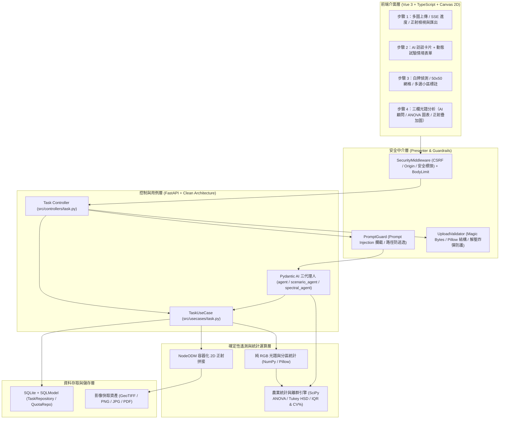

# 系統設計規格書 (DESIGN.md)

> **專題名稱**：田間無人機影像智慧決策系統（Agricultural Drone Field Trial Intelligence）  
> **線上體驗入口**：[https://5114050012.duckdns.org](https://5114050012.duckdns.org)  
> **規範對齊**：本文件嚴格對齊課程最終交付標準 [COURSE.md](docs/proposal/COURSE.md)，涵蓋 **Problem、Requirements、Architecture、Components、Data Flow、AI Model、Domain Knowledge、Security Architecture、Algorithm、Implementation Mapping、How to Run、Results 與 Limitations**，確保接手者僅憑本儲存庫即可理解架構、重現實驗並持續開發。

---

## 1. Problem & Requirements (問題定義與核心需求)

傳統田間農藥與作物試驗高度仰賴人力巡田目測評分，不僅耗時費力，也容易受到主觀誤差與田間微地形異質性干擾。本系統以消費級無人機高解析度 RGB 空拍影像為輸入，透過 **確定性攝影測量與純 RGB 光譜統計引擎** 搭配 **領域智慧代理人（Domain AI Agent）**，建立從「空拍拼接 → 試驗情境規劃 → 小區標註 → 統計檢定與視覺判讀」的一站式四步驟可追溯決策流程。

核心系統需求（詳見 [REQUIREMENT.md](REQUIREMENT.md)）：
- **確定性計算與 AI 職責分離**：影像拼接、像素遮罩、純 RGB 指標、單因子 ANOVA、Tukey HSD 與離群小區偵測一律由確定性 Python 演算法執行；AI 代理人專責情境引導、指標推薦、統計數據解讀與局部影像多模態診斷，嚴禁捏造數據或偽造近紅外波段（NDVI / NDRE）。
- **雙軌解讀原則**：同處理組內出現高變異或離群小區時，系統主動標示異常並支援一鍵定位至正射圖排查，**嚴禁自動剔除小區**。
- **縱深資訊安全防護**：涵蓋 CSRF / Origin 驗證、標準 HTTP 安全標頭、上傳影像 Magic Bytes 與 Pillow 結構防偽檢核、目錄防逃逸、AI Prompt Injection 前置攔截與全站每日 AI 配額鎖。

---

## 2. Architecture (系統架構)

後端嚴格遵循 **Clean Architecture 四層架構**（Entities → Use Cases & Ports → Repositories / Requesters → Controllers & Presenter），前端採用 Vue 3 + TypeScript + HTML5 Canvas 互動工作區，整體以 Docker Compose 部署於 GCP Compute Engine（Caddy 自動 HTTPS + DuckDNS + IAP 專屬管理通道）：



---

## 3. Components (模組元件職責)

### 後端模組（`src/`）

| 層級 | 檔案路徑 | 核心職責 |
| :--- | :--- | :--- |
| **入口與設定** | [`src/main.py`](src/main.py)、[`src/config.py`](src/config.py) | FastAPI 應用工廠、生命週期初始化、Logfire 遙測、環境參數與安全上限設定 |
| **安全中介層** | [`src/presenter/security.py`](src/presenter/security.py)、[`src/presenter/body_limit.py`](src/presenter/body_limit.py) | 無狀態 CSRF / Origin / `Sec-Fetch-Site` 防護、標準安全回應標頭注入、請求體積限制 |
| **上傳與配額** | [`src/controllers/uploads.py`](src/controllers/uploads.py)、[`src/controllers/limits.py`](src/controllers/limits.py) | Magic Bytes＋Pillow 影像結構防偽、150MP 解壓炸彈防護、安全檔名清理、全站每日 AI 請求配額鎖 |
| **主控制器** | [`src/controllers/task.py`](src/controllers/task.py) | 任務生命週期 API、SSE 進度串流、小區／情境 CRUD、影像匯出、Prompt Injection 前置攔截與對話串流 |
| **領域實體** | [`src/entities/task.py`](src/entities/task.py)、[`src/entities/upload.py`](src/entities/upload.py) | 純 Python `dataclass` 定義 `Task` 聚合根、`Plot` 內嵌實體與 `UploadImage` |
| **用例與介面** | [`src/usecases/task.py`](src/usecases/task.py)、[`src/usecases/ports/`](src/usecases/ports/) | 業務協調與情境資料正規化；透過抽象 `TaskPort` / `OdmPort` 達成依賴倒置 |
| **倉儲與配接器** | [`src/repositories/task_repo.py`](src/repositories/task_repo.py)、[`src/requesters/odm.py`](src/requesters/odm.py) | SQLite 持久化（以 `asyncio.to_thread` 調度）與雙頻道對話隔離；NodeODM HTTP API 通訊配接器 |
| **AI 代理人** | [`src/agents/pydantic_agent.py`](src/agents/pydantic_agent.py) | 實作 `agent`、`scenario_agent`、`spectral_agent` 與多模態 `vision_agent` 及所有結構化工具 |
| **確定性運算** | [`src/utility/formulas.py`](src/utility/formulas.py)、[`src/utility/spectral.py`](src/utility/spectral.py)、[`src/utility/region_statistics.py`](src/utility/region_statistics.py) | 5 項純 RGB 指標公式、256 階假色階熱圖生成、多邊形像素中心遮罩、單因子 ANOVA、Tukey HSD 分群字母與自適應離群偵測 |
| **影像與護欄工具** | [`src/utility/marker_detection.py`](src/utility/marker_detection.py)、[`src/utility/image_export.py`](src/utility/image_export.py)、[`src/utility/prompt_guard.py`](src/utility/prompt_guard.py) | OpenCV 白色定位牌偵測、GeoTIFF/JPG/PDF 匯出、Prompt Injection 規則攔截與目錄防逃逸 |

### 前端模組（`frontend/src/`）

| 檔案路徑 | 核心職責 |
| :--- | :--- |
| [`App.vue`](frontend/src/App.vue)、[`StepNavigationHUD.vue`](frontend/src/components/StepNavigationHUD.vue) | 四步驟工作流協調、全版零捲動黑底畫布與置底懸浮步驟切換膠囊 |
| [`DroneHomeUpload.vue`](frontend/src/components/DroneHomeUpload.vue)、[`ImageDownloadPanel.vue`](frontend/src/components/ImageDownloadPanel.vue) | 多圖拖曳上傳、EXIF 解析、AbortController 取消上傳與獨立非模態影像匯出面板 |
| [`ScenarioWorkspace.vue`](frontend/src/components/ScenarioWorkspace.vue)、[`ScenarioQuestionCard.vue`](frontend/src/components/ScenarioQuestionCard.vue)、[`ProjectScenarioCard.vue`](frontend/src/components/ProjectScenarioCard.vue) | 步驟 2 AI 逐題訪談互動卡片、即時同步動態組別表單與 CK 鎖定保護 |
| [`PlotCanvasOverlay.vue`](frontend/src/components/PlotCanvasOverlay.vue)、[`PlotToolbar.vue`](frontend/src/components/PlotToolbar.vue)、[`PlotTreatmentDialog.vue`](frontend/src/components/PlotTreatmentDialog.vue) | 步驟 3 小區多邊形／矩形繪製、雙線性網格（最高 50×50）、剛體拖曳、框選多選與批次指派 |
| [`SpectralWorkspace.vue`](frontend/src/components/SpectralWorkspace.vue)、[`SpectralStatsPanel.vue`](frontend/src/components/SpectralStatsPanel.vue)、[`SpectralGroupChart.vue`](frontend/src/components/SpectralGroupChart.vue)、[`SpectralChatPanel.vue`](frontend/src/components/SpectralChatPanel.vue) | 步驟 4 三欄可拖曳工作區：唯讀 AI 顧問對話、長條圖 (±SD)／箱型圖與 Tukey 字母圖表、離群小區一鍵定位與正射／光譜疊加檢視 |

---

## 4. Data Flow & Persistence (資料流與儲存模型)

1. **步驟 1（航拍與正射）**：多圖上傳 → `prepare_uploads`（Magic Bytes＋Pillow 驗證）→ `NodeODM` 2D 精簡管線（`--skip-3dmodel --skip-report`, `pc-quality: low`, `feature-quality: high`）→ SSE `/api/task/odm-task-stream/{task_id}` 即時推播 → 完成後快取原始 GeoTIFF 與高速壓縮 PNG（`compress_level=1`）。
2. **步驟 2（試驗情境規劃）**：`POST /api/task/chat` (`mode="scenario"`) → `scenario_agent` 透過 `ask_clarifying_question` 逐題釐清並以 `upsert_trial_scenario_form` 即時推送 `scenario_updated` 事件寫入 `Task.scenario`（含鎖定首列 CK 與 `recommended_formulas`）。
3. **步驟 3（小區標註）**：正規化相對座標 `[0.0, 1.0]` 以 JSON 陣列持久化至 `Task.plots`，透過 `PUT /api/task/plots/{task_id}` 自動儲存，確保任意視窗縮放與旋轉皆精準對齊原始正射解析度。
4. **步驟 4（光譜統計與檢定）**：`GET /api/task/plots-statistics/{task_id}` 單次開啟原圖計算所有小區 RGB、5 項純 RGB 指標、處理組均值／SD／CV%／四分位數、單因子 ANOVA、Tukey HSD 分群字母與離群小區警示；對話歷史分為 `default`（步驟 2）與 `spectral`（步驟 4）雙頻道隔離儲存於 SQLite。

---

## 5. AI Model & Multi-Agent Design (AI 模型與三代理人架構)

系統採用 [Pydantic AI](https://ai.pydantic.dev/) 作為結構化工具調度框架，搭配 Gemini 多模態模型，並依工作流階段切分為三個職責邊界嚴格隔離的代理人：

1. **`scenario_agent`（步驟 2 試驗情境規劃）**：
   - 工具：`ask_clarifying_question`（產生結構化單／複選互動卡片）、`upsert_trial_scenario_form`（即時建置或更新動態欄位、組別與步驟 4 適用純 RGB 光譜清單 `recommended_formulas`）。
2. **`spectral_agent`（步驟 4 唯讀光譜顧問）**：
   - **嚴格唯讀邊界**：不具備任何修改資料庫、表單或小區的工具。
   - 工具：`get_selected_plots_spectral_stats`（讀取真實小區統計、相對 CK 差值、SD/CV%、ANOVA/Tukey 字母與離群警示）、`inspect_plot_imagery`（依小區多邊形裁切正射或光譜圖交由 `vision_agent` 進行多模態視覺判讀）、`query_vegetation_index`（查詢純 RGB 指標公式與物理限制）。
3. **`agent`（通用助手）**：提供專案狀態、全圖統計與視覺全景診斷。

---

## 6. Domain Knowledge (農業領域知識整合)

1. **純 RGB 可見光植生／色彩指標**（皆歸一化至 `0~1` 計算，不偽造 NIR）：
   - `VARI` = $(G - R) / (G + R - B)$（可見光大氣阻抗指標）
   - `EXG` = $2G - R - B$（超綠指標，有效分離裸土與植被）
   - `GLI` = $(2G - R - B) / (2G + R + B)$（綠葉指標）
   - `MPRI` = $(G - R) / (G + R)$（RGB 替代光化學反射指標，數學上等同 NGRDI）
   - `NDYI` = $(G - B) / (G + B)$（歸一化黃度指標）
2. **田間試驗設計與推論統計**：
   - 依據 EPPO PP 1/152 原則，強制鎖定唯一基準對照組（CK），支援多重複配置與走道內縮（Margin Gap）排除裸土邊際效應。
   - 實作 **單因子 ANOVA** 與 **Tukey HSD** 事後多重比較，透過 Bron-Kerbosch 最大團演算法輸出農藝論文標準之 **Compact Letter Display（`a / b / ab`）**。
3. **自適應離群偵測與雙軌解讀**：
   - 重複數 $n \ge 4$ 採 $1.5 \times \text{IQR}$ 判定；典型田間 3 重複（$n = 3$）改採「組內 $\text{CV}\% > 15\%$ 且偏離組中位數最遠者」標記為需複查小區。所有異常小區皆保留於資料集中供點擊地圖排查。

---

## 7. Security Architecture (資訊安全縱深防禦)

| 防禦層級 | 實作位置 | 防護機制 |
| :--- | :--- | :--- |
| **傳輸與網路邊界** | [`deploy/Caddyfile`](deploy/Caddyfile)、[`scripts/bootstrap_gcp.sh`](scripts/bootstrap_gcp.sh) | Caddy 全自動 Let's Encrypt HTTPS；防火牆僅開放 80/443，SSH 嚴格鎖定 GCP IAP 網段（`35.235.240.0/20`），NodeODM 與 FastAPI 絕不對外暴露 |
| **Web 中介層防禦** | [`src/presenter/security.py`](src/presenter/security.py)、[`src/presenter/body_limit.py`](src/presenter/body_limit.py) | 攔截 `Sec-Fetch-Site: cross-site` 與異常 `Origin` 之寫入請求（403）；全面注入 `X-Content-Type-Options: nosniff`、`X-Frame-Options: DENY`、`Referrer-Policy`、`Permissions-Policy`；嚴格限制上傳體積 |
| **檔案上傳與路徑安全** | [`src/controllers/uploads.py`](src/controllers/uploads.py)、[`src/utility/prompt_guard.py`](src/utility/prompt_guard.py) | Magic Bytes＋Pillow `Image.verify()` 結構防偽＋150MP 解壓炸彈上限；清理跨平台路徑穿越檔名；`ensure_within_directory` 阻擋 `ODM_DIR` 路徑逃逸 |
| **AI 安全與成本護欄** | [`src/utility/prompt_guard.py`](src/utility/prompt_guard.py)、[`src/controllers/limits.py`](src/controllers/limits.py) | `check_prompt_injection` 於呼叫 LLM 與讀寫歷史前直接攔截指令覆寫、提示詞外洩與 SQL／越權指令；三個代理人系統提示詞嵌入最高優先級安全護欄；全站每日 AI 配額鎖防止 API 濫用 |

---

## 8. Algorithm (核心演算法虛擬碼)

```text
Algorithm 1: 具統計檢定、離群偵測與資安護欄之 RGB 空拍小區決策流程
Input : H (空拍影像集), B (田區四角座標), G (行列數), S (試驗情境與組別), Q (使用者提問)
Output: V (正射/光譜疊加圖), Stats (分區均值/SD/CV%/ANOVA/Tukey 字母/離群警示), R (AI 診斷回應)

01: ValidateUploads(H)  // Magic Bytes + Pillow 結構驗證 + 150MP 解壓炸彈防護 + 檔名清理
02: I ← Stitch2DOrthophotoViaNodeODM(H)
03: P ← InteractiveGridAndManualPlots(I, B, G)  // 正規化相對座標 [0, 1] 持久化
04: F_rec ← ScenarioAgent.RecommendPureRGBIndices(S)
05: for each plot p in P do:
06:     pixels_p ← ExtractNonTransparentPolygonPixels(I, p)
07:     PlotStats[p] ← ComputePureRGBIndices(pixels_p)
08: end for
09: for each formula f in F_rec do:
10:     GroupStats[f] ← AggregateMeanStdCVQuartiles(PlotStats, S, f)
11:     AnovaTukey[f] ← RunOneWayAnovaAndTukeyCLD(GroupStats[f])  // n < 2 時優雅降級
12:     Outliers[f] ← DetectAdaptiveOutliers(PlotStats, S, f)      // n>=4: 1.5xIQR; n=3: CV>15%
13: end for
14: if CheckPromptInjection(Q).blocked then return SafeRefusal()
15: R ← SpectralAgent.DiagnoseReadOnly(Q, GroupStats, AnovaTukey, Outliers, CroppedImagery)
16: return V, (PlotStats, GroupStats, AnovaTukey, Outliers), R
```

---

## 9. How to Run & Reproduce (安裝、執行與實驗重現)

### 環境需求
- Python 3.13+ 與 [uv](https://docs.astral.sh/uv/)
- Node.js 20+ 與 npm
- Docker & Docker Compose（啟動本地 NodeODM 正射拼接引擎）

### 本機開發啟動
```bash
# 1. 複製環境變數設定並填入 GEMINI_API_KEY
cp .env.example .env

# 2. 安裝後端相依套件並啟動 FastAPI
uv sync
uv run uvicorn src.main:app --reload --port 8000

# 3. 另開終端機安裝前端套件並啟動 Vite（自動代理 /api 至 8000）
cd frontend
npm install
npm run dev
```

### Docker Compose 一鍵啟動（含 NodeODM）
```bash
docker compose up --build
```

### 測試與量化實驗重現
```bash
# 後端全套單元與資安攻防測試（68 項）
uv run pytest

# 前端單元測試與正式建置驗證
npm --prefix frontend test
npm --prefix frontend run build

# 重現真實空拍資料集四組量化實驗（輸出 docs/experiments/results.json 與 README.md）
uv run python scripts/run_experiments.py
```

---

## 10. Experiments & Results (實測實驗結果)

完整可重現數據詳見 [`docs/experiments/README.md`](docs/experiments/README.md) 與 [`docs/experiments/results.json`](docs/experiments/results.json)：

1. **真實空拍資料集**：以 `odm/images/` 內 **65 張高解析度空拍相片**（5280 × 3956 px，共 540.35 MiB）拼接產出 `1385 × 1647 px` RGBA 正射圖（4.56 MiB，有效非透明像素佔比 **73.57%**）。
2. **PNG 影像轉檔效能優化（Baseline vs 優化）**：
   - Baseline（Pillow 預設 `compress_level=6`）：`0.197 s`（4.56 MiB）
   - 本系統優化（`compress_level=1`）：`0.095 s`（5.93 MiB）→ **編碼耗時降低 51.6%（加速 2.07×）**。
3. **全套 5 項純 RGB 分區統計與 ANOVA／Tukey 效能＋重現性**：
   - 針對真實正射圖 12 個試驗小區（4 組 × 3 重複）單次同時完成 5 項光譜指標、組內 SD/CV%、單因子 ANOVA、Tukey HSD 與離群偵測僅耗時 **0.377 ~ 0.425 秒**，且連續重跑數值達到 **100% 位元級確定性一致**。
4. **AI 與 Web 資安攻防實測**：
   - Prompt Injection 攻防測試集：惡意攻擊攔截率 **100.0%（10 / 10）**，合法農藝光譜查詢誤判率 **0.0%（0 / 10）**。
   - 惡意檔案上傳驗證（HTML 偽裝、偽造 JPEG 檔頭 Polyglot、跨平台路徑穿越、正常影像）：**4 / 4 全部通過**。
   - 自動化測試總計：後端 **68 passed**（含 16 項資安測試）、前端測試全數通過。

---

## 11. Limitations & Future Work (系統限制與未來展望)

- **純 RGB 光譜物理邊界**：無近紅外（NIR）與紅邊（Red-Edge）波段，作物高覆蓋度後期易出現綠度飽和，且無法偵測肉眼未顯徵前的早期隱性逆境；未來取得多光譜相機與輻射校正板後可擴充 NDRE / NDVI。
- **非正式法定登記藥效**：目前提供影像光譜統計差異與 Tukey HSD 分群，尚未串接人工害蟲計數與 Abbott's / Henderson-Tilton 法定藥效校正公式。
- **光照與時序延伸**：單次航拍品質仍受當日雲影與色溫影響；後續可擴充「施藥前 vs 施藥後多時序跨任務對照」與「一鍵生成含圖表與 AI 結論的正式 PDF 試驗報告」。
