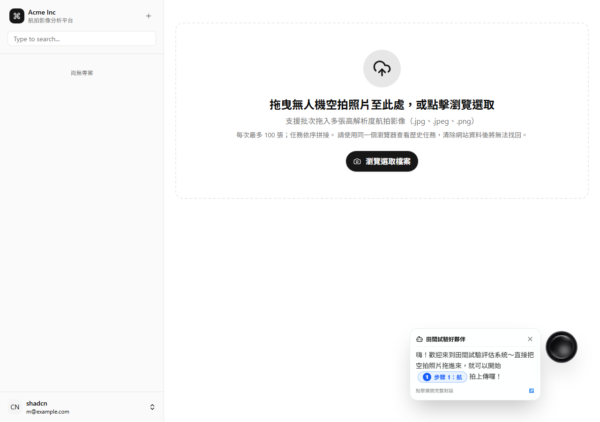
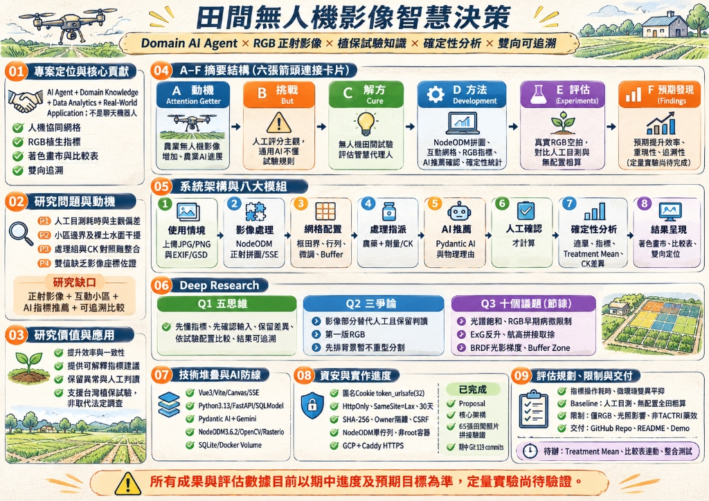

# 田間無人機影像智慧決策

> 🌐 **線上系統體驗入口**：[https://5114050012.duckdns.org](https://5114050012.duckdns.org)

## 影像下載

進入專案後，點選頁首「下載影像」，選擇原始正射圖或 RGB 光譜演算法，以及 TIFF、JPG 或 PDF 格式。下載面板獨立於四步驟導覽，不切換主畫布、不變更小區或情境設定；收起面板後下載繼續，可照常操作步驟條。切換專案或回到首頁會取消尚未完成的下載。拼接完成後即可下載，不要求先建立小區。

- 正射 TIFF 直接下載 NodeODM 原始檔案，保留原始像素與地理資訊；只有 PNG 快取的舊專案會重新取得原始 TIFF，來源無法取得時顯示錯誤，不會將 PNG 假裝為原始 GeoTIFF。
- 光譜圖支援 NDYI、VARI、MPRI、EXG、GLI，與主畫布使用相同著色運算；TIFF 保留透明度並複製來源地理定位標籤，內容為著色影像而非原始浮點指數矩陣。
- JPG／PDF 使用完整尺寸影像，透明區域填白；PDF 為維持長寬比例的單頁影像文件。匯出不含小區邊框、畫布工具或地理定位資訊。格式編碼使用 [Pillow](https://pillow.readthedocs.io/en/stable/handbook/image-file-formats.html)，無新增正式環境套件。
- 下載端點：`GET /api/task/odm-task-export/{task_id}?formula=rgb&format=tiff`；`formula` 可改為支援的演算法，`format` 接受 `tiff`、`jpg`、`pdf`。以 [FastAPI FileResponse](https://fastapi.tiangolo.com/advanced/custom-response/#fileresponse) 傳送具檔名的附件。
- 面板採用 [Reka UI 非模態 Dialog](https://reka-ui.com/docs/components/dialog)，開關與下載狀態獨立於步驟條；影像轉換在背景執行緒進行，同一成果的並行請求共用快取鎖，完成寫入後才公開檔案。

驗證：根目錄執行 `uv run pytest`，前端目錄執行 `npm test` 與 `npm run build`。測試涵蓋全部影像／格式組合、原始 TIFF 位元組與地理標籤、PDF 內容與比例、取消／重試，以及主流程與未儲存小區保護。[pytest](https://docs.pytest.org/)、[Vitest](https://vitest.dev/guide/)、[Vue Test Utils](https://test-utils.vuejs.org/)

## 框選區域數值比較

在步驟 3 或步驟 4 點選已框選的小區，左上角會顯示原始輸入影像的平均 RGB，以及 5 項純 RGB 演算法（NDYI、VARI、MPRI、EXG、GLI）的平均指數與熱圖著色後平均 RGB。點選面板內的演算法名稱即可切換影像；移動小區或調整頂點後自動重新計算，不需要先儲存。面板可收合，多選時可在下拉選單選擇要查看的小區。

- 統計取自完整解析度正射影像，以像素中心是否位於多邊形內判定，排除完全透明像素；不納入框線、標籤或畫面縮放效果。RGB 採各通道算術平均，保留兩位小數，範圍為 0–255。[Pillow 影像裁切](https://pillow.readthedocs.io/en/stable/reference/Image.html#PIL.Image.Image.crop)、[NumPy 平均值](https://numpy.org/doc/stable/reference/generated/numpy.mean.html)
- **原圖 RGB 與演算法著色 RGB 來源區別**：表格中「原圖 RGB」列為框內原始輸入影像之真實 R/G/B 平均；各演算法列之「著色 R / G / B」則為套用 256 階紅（`[255,0,0]`）→ 黃（`[255,255,0]`）→ 綠（`[0,255,0]`）假色階後之輸出影像 RGB 平均。因該假色階不含藍色，所有演算法列之著色平均 B 通道固定為 `0.00` 屬預期現象，並非輸入影像遺失藍色通道。
- **純 RGB 植生／色彩指標公式與限制**（皆以歸一化至 `0~1` 之純 RGB 三通道計算，不依賴 NIR 或 531nm/570nm 窄波段）：
  - `NDYI`：`(G - B) / (G + B)`（歸一化黃度指數，易受色溫與白平衡影響）
  - `VARI`：`(G - R) / (G + R - B)`（可見光大氣阻抗指數，高覆蓋度易飽和）
  - `MPRI`：`(G - R) / (G + R)`（**RGB 替代公式**，數學上等同 NGRDI，並非 531nm/570nm 窄波段之原始光化學反射指數 PRI）
  - `EXG`：`(2 * G) - (R + B)`（超綠指數，直接以 `0~1` RGB 計算而非色度歸一化 `2g - r - b`）
  - `GLI`：`((G * 2) - R - B) / ((G * 2) + R + B)`（綠葉指數，僅反映可見光綠度比例）
- 平均指數先對每個像素套用純 RGB 公式，再平均有限值，不先平均 RGB，也不截斷指數；無效指數排除，沒有有效值時顯示「無有效值」。[NumPy 有限值判定](https://numpy.org/doc/stable/reference/generated/numpy.isfinite.html)
- `POST /api/task/region-statistics/{task_id}` 接受 `{"points": [[0,0],[1,0],[1,1],[0,1]]}` 格式的正規化座標，回傳有效像素數、原圖平均 RGB 與各演算法統計，不寫入小區資料。[FastAPI 請求內容](https://fastapi.tiangolo.com/tutorial/body/)

## 人工智慧與資訊安全期末專題提案

> **專案期程**：2026 年 9 月 7 日 至 12 月 21 日  
> **核心定位**：以高解析度正射影像（地面取樣距離 [GSD](https://en.wikipedia.org/wiki/Ground_sample_distance) < 1 cm/px）為核心輸入，結合植保領域知識與確定性分析工具，由 AI Agent 評估田間試驗藥效並產出具可追溯證據之報告草稿。

### 章節目錄

| 編號 | 章節名稱 | 內容摘要 |
| :---: | :--- | :--- |
| 01 | [摘要 (Abstract)](docs/proposal/01_abstract.md) | 研究動機、產業痛點、解法架構與預期成效 |
| 02 | [緒論 (Introduction)](docs/proposal/02_introduction.md) | 田間試驗背景、現有限制與五大預期貢獻 |
| 03 | [相關文獻 (Related Work)](docs/proposal/03_related_work.md) | 農業多模態 AI / Agent、植生指標與法規文獻整理 |
| 04 | [深度探討 (Deep Research)](docs/proposal/04_deep_research.md) | 核心思維模式、關鍵爭論與技術 Q&A |
| 05 | [系統設計 (Proposed Scheme)](docs/proposal/05_proposed_scheme.md) | 系統架構圖、ReAct 調度流程與演算法虛擬碼 |
| 06 | [參考文獻 (References)](docs/proposal/06_references.md) | 22 篇論文文獻與 TACTRI / EPPO 法規標準 |

---

## 團隊成員分工

| 角色 | 成員 | 負責面向 |
| :--- | :--- | :--- |
| **Domain Lead（農業/植保）** | [@Kuonaiwei1126](https://github.com/Kuonaiwei1126) | 試驗資料與 Ground Truth、領域知識庫、評估指標設計、結果驗證 |
| **AI/System Lead（資訊/系統）** | [@ChengLiangHsu](https://github.com/ChengLiangHsu) | Agent 架構、影像分析工具、Tool 整合、GitHub、DESIGN.md |
