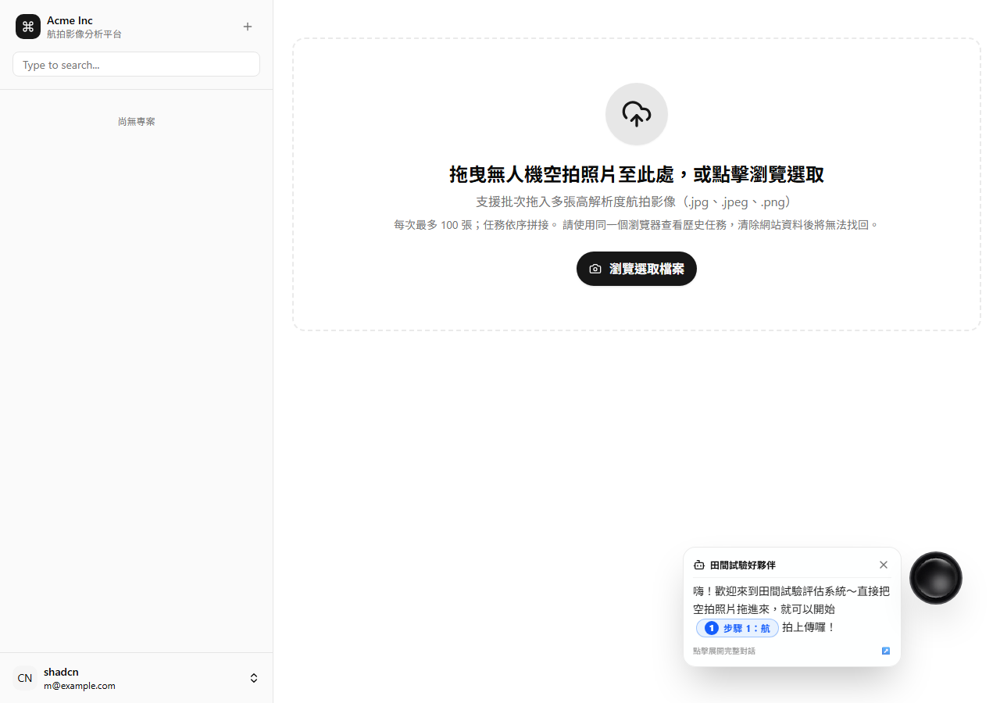

# 無人機田間試驗評估智慧代理人



## 人工智慧與資訊安全期末專題提案

> **專案期程**：2026 年 9 月 7 日 至 12 月 21 日  
> **核心定位**：以高解析度正射影像（地面取樣距離 [GSD](https://en.wikipedia.org/wiki/Ground_sample_distance) < 1 cm/px）為核心輸入，結合植保領域知識與確定性分析工具，由 AI Agent 評估田間試驗藥效並產出具可追溯證據之報告草稿。

### 章節目錄

| 編號 | 章節名稱 | 內容摘要 |
| :---: | :--- | :--- |
| 01 | [摘要 (Abstract)](docs/proposal/01_abstract.md) | 研究動機、產業痛點、解法架構與預期成效 |
| 02 | [緒論 (Introduction)](docs/proposal/02_introduction.md) | 田間試驗背景、現有限制與五大預期貢獻 |
| 03 | [相關文獻 (Related Work)](docs/proposal/03_related_work.md) | 農業多模態 AI / Agent、植生指標與法規文獻整理 |
| 04 | [深度探討 (Deep Research)](docs/proposal/04_deep_research.md) | 核心思維模式、關鍵爭論與技術 Q&A |
| 05 | [系統設計 (Proposed Scheme)](docs/proposal/05_proposed_scheme.md) | 系統架構圖、ReAct 調度流程與演算法虛擬碼 |
| 06 | [參考文獻 (References)](docs/proposal/06_references.md) | 22 篇論文文獻與 TACTRI / EPPO 法規標準 |

---

## 團隊成員分工

| 角色 | 成員 | 負責面向 |
| :--- | :--- | :--- |
| **Domain Lead（農業/植保）** | [@Kuonaiwei1126](https://github.com/Kuonaiwei1126) | 試驗資料與 Ground Truth、領域知識庫、評估指標設計、結果驗證 |
| **AI/System Lead（資訊/系統）** | [@ChengLiangHsu](https://github.com/ChengLiangHsu) | Agent 架構、影像分析工具、Tool 整合、GitHub、DESIGN.md |

---

## 本機整合啟動

需要 [Docker Engine 與 Compose](https://docs.docker.com/compose/install/)。首次設定時複製 `.env.example` 為 `.env`，填入自己的 `GEMINI_API_KEY` 與可用模型；既有 `.env` 請保留並補齊設定。

```bash
docker compose up -d --build --wait
```

開啟 <http://localhost:8000>。映像檔會使用 Node 24 建置 Vue，再將 `frontend/dist` 放入 Python 3.13／FastAPI 容器；NodeODM 只供內部連線。資料放在具名 Volume，正式程序採單一 worker，確保任務派送鎖有效。[多階段建置](https://docs.docker.com/build/building/multi-stage/)、[Compose 網路](https://docs.docker.com/compose/how-tos/networking/)

| 路徑 | 用途 |
|---|---|
| `/`、`/assets/...` | Vue 網頁及靜態檔案 |
| `/api/session` | 建立／延長匿名訪客身分，回傳上傳限制 |
| `/api/task/...` | 任務、影像、小區與對話 API |
| `/healthz` | 應用存活狀態，不代表 NodeODM 或 AI 可用 |
| `/docs`、`/openapi.json` | 最新 API 契約 |

後端路由已由 `/task/...` 統一為 `/api/task/...`；直接呼叫舊路徑的用戶端需要更新。Vite 開發代理也保留 `/api`。靜態檔案掛載在 API 之後，不將不存在的 API 回傳成首頁。[FastAPI 靜態檔案](https://fastapi.tiangolo.com/tutorial/static-files/)

## 個別資料與容量

- 每位匿名訪客以隨機 Cookie 憑證識別，資料庫僅儲存憑證雜湊；任務以 `owner_id` 隔離，所有讀寫、影像與 AI 工具均驗證擁有者。Cookie 有效期為最後一次 API 存取後 30 天；清除網站資料、換裝置或到期後無法自動找回舊任務。[工作階段管理](https://cheatsheetseries.owasp.org/cheatsheets/Session_Management_Cheat_Sheet.html)
- SQLite、影像快取與訪客資料存在 `app_data`，NodeODM 原始照片與成果存在 `nodeodm_data`；NodeODM 已完成任務保留 90 天。`docker compose down` 保留 Volume；`down -v` 會刪除資料，日常更新請使用 `up -d --build`。[Volume 文件](https://docs.docker.com/engine/storage/volumes/)、[NodeODM 設定](https://github.com/OpenDroneMap/NodeODM/blob/master/config.js)
- 預設每件最多 100 張、每張 25 MiB、整件 1 GiB；全站最多三件排隊或執行中的任務，NodeODM 一次拼接一件、使用最多三條運算執行緒。超出容量時回傳明確錯誤，設定可由 `.env` 調整。
- AI 預設全站每日 100 次請求（UTC 換日），計數保存在 SQLite；這是應用程式配額，模型的實際費用與免費額度請確認 [Gemini API 計費設定](https://ai.google.dev/gemini-api/docs/billing)。

## Google Cloud 公開上線

採用單台 Compute Engine：預設 `asia-east1-b`、`e2-highmem-4`（4 vCPU／32 GiB）、150 GB 持久磁碟。這是初始容量配置，需用實際最大照片批次驗證，並非三件同時運算的效能承諾。[機型規格](https://docs.cloud.google.com/compute/docs/general-purpose-machines#e2_machine_types)

Google Cloud 新用戶試用為 US$300／90 天；此機型、磁碟與 IPv4 會消耗額度，並非長期免費主機。額度耗盡或到期前需備份，未升級付費帳戶時試用資源會停止；腳本不會升級帳戶。[試用條件](https://docs.cloud.google.com/free/docs/free-cloud-features)

1. 開通 Google Cloud 免費試用，建立專案並啟用試用帳務。安裝 [Google Cloud CLI](https://docs.cloud.google.com/sdk/docs/install)，執行 `gcloud auth login`。部署帳號需具備建立運算與網路資源、SSH 及 [IAP 通道](https://docs.cloud.google.com/iap/docs/using-tcp-forwarding) 的權限。
2. 在 [DuckDNS](https://www.duckdns.org/) 註冊免費子網域；複製 `.env.cloud.example` 為 `.env.cloud`，填入專案 ID、完整子網域及 DuckDNS Token。金鑰只放在本機設定檔。
3. 確認 `.env` 的模型與金鑰可用，再執行：

```bash
bash scripts/deploy_gcp.sh
```

腳本會建立專用網路、固定 IPv4 與主機，更新 DNS，傳送程式及執行設定，並建置、啟動服務。公開入口由 Caddy 處理 HTTPS，Vue 網頁仍由 FastAPI 提供；僅公開 80／443，SSH 經 IAP，8000 與 NodeODM 不直接對外。[Caddy HTTPS](https://caddyserver.com/docs/automatic-https)、[DuckDNS API](https://www.duckdns.org/spec.jsp)

部署目錄為 `/opt/drone-field/current`，歷次程式版本保存在 `/opt/drone-field/releases`。再次執行同一腳本會使用原主機與 Volume 更新程式；若原主機已停止，會先啟動再等待 SSH 就緒。Google Cloud 專案、試用資格及 DuckDNS 註冊必須先由帳號持有人完成。[啟動既有主機](https://docs.cloud.google.com/sdk/gcloud/reference/compute/instances/start)

## 更新、備份與還原

以下命令在部署主機上、沒有正在拼接的任務時執行。停止期間網站會暫停服務；備份包含 SQLite、訪客憑證雜湊及原始照片，請保存於受控位置並下載到另一台電腦。

```bash
cd /opt/drone-field/current
backup_dir="$HOME/drone-backup-$(date +%Y%m%d-%H%M%S)"
mkdir -m 700 "$backup_dir"
sudo docker compose -p drone-field stop app nodeodm
sudo docker compose -p drone-field cp -a app:/data "$backup_dir/app-data"
sudo docker compose -p drone-field cp -a nodeodm:/var/www/data "$backup_dir/nodeodm-data"
sudo docker compose -p drone-field up -d --wait
```

還原時使用新建的空 Volume，在服務停止狀態下透過 `docker compose cp -a` 將備份內容複製回上述兩個目錄；`app_data` 檔案擁有者需為 UID 10001，並一併還原訪客表，原有 Cookie 才能繼續使用。切勿將兩份不同部署的資料庫或 NodeODM 資料混用。[複製資料與保留擁有者](https://docs.docker.com/reference/cli/docker/compose/cp/)

程式回退可進入上一個 release 目錄，執行 `sudo docker compose -p drone-field --profile public up -d --no-build --wait`；Volume 沿用，資料庫版本相容性須先確認。本次遷移只新增擁有者欄位及新資料表，舊任務內容保留。

停用展示時可停止 VM；持久磁碟與保留的 IPv4 仍可能計費。完全結束前先下載備份，再從 Cloud Console 移除本次專用資源並檢查帳務。[Compute Engine 計費](https://cloud.google.com/products/compute/pricing)

## 舊任務移轉

首次啟動會自動替舊 `tasks` 表新增 `owner_id`；未指派的舊任務只保留在資料庫中，不會公開給任何新訪客。資料庫與原有 `src/odm` 快取若要搬到容器，請在停止服務時分別複製到 `app_data` 的 `database.sqlite` 與 `odm`，並保留原檔備份。

部署者可在目標瀏覽器開啟 `/api/session` 取得 `visitor_id`，再於主機明確指派指定舊任務：

```bash
docker compose exec app python -m src.manage legacy-tasks
docker compose exec app python -m src.manage assign-owner --task-id 任務UUID --visitor-id 訪客UUID
```

此管理命令只接受尚未指派的舊任務，不提供公開認領 API。

## 分開開發

本機使用 Python 3.13、[uv](https://docs.astral.sh/uv/) 與 Node 24；以下命令分別在不同終端機執行。

```bash
uv sync
uv run fastapi dev src/main.py
```

```bash
cd frontend
npm ci
npm run dev
```

```bash
docker run --rm -p 127.0.0.1:3002:3000 opendronemap/nodeodm:3.6.2 --parallel_queue_processing 1
```

本機開發 `.env` 保持 `COOKIE_SECURE=false`、`PUBLIC_ORIGIN` 留空；雲端部署腳本會設定 HTTPS 網域及安全 Cookie。本機預設資料路徑仍為根目錄 `database.sqlite` 與 `src/odm`，可用 `DATABASE_PATH`、`ODM_DIR` 覆寫。
