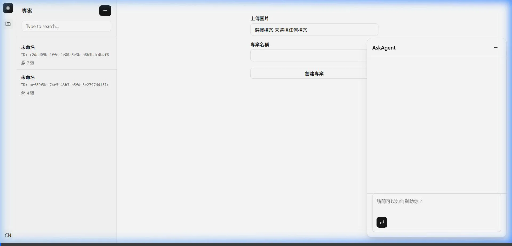

# 無人機田間試驗評估智慧代理人



**人工智慧與資訊安全期末專題提案**

* **專案日期：** 2026 年 9 月 7 日至 12 月 21 日
* **提案人：** [@Kuonaiwei1126](https://github.com/Kuonaiwei1126)、[@ChengLiangHsu](https://github.com/ChengLiangHsu)
* **核心定位：** 以高解析度、地面取樣距離（Ground Sample Distance, GSD）< 1 cm/px 的無人機正射影像為輸入，結合植保領域知識與分析工具，由 AI Agent 評估田間試驗藥效並產出可追溯證據之報告草稿。

---

## 專案啟動步驟

### 1. 環境需求
* **Python**：>= 3.13
* **uv**：Python 套件與環境管理工具
* **Node.js**：>= 18 與 npm

### 2. 後端啟動 (FastAPI)
1. **安裝依賴套件**：
   ```bash
   uv sync
   ```
2. **設定環境變數**：
   於專案根目錄建立 `.env` 檔案並設定金鑰與模型：
   ```env
   PYDANTIC_AI_MODEL=google:gemini-3.7-flash
   GEMINI_API_KEY=your_gemini_api_key
   ```
3. **啟動後端服務**：
   ```bash
   uv run fastapi dev src/main.py
   ```
   後端預設服務網址為 `http://127.0.0.1:8000`。

### 3. 前端啟動 (Vue 3 + Vite)
1. **切換至前端目錄並安裝套件**：
   ```bash
   cd frontend
   npm install
   ```
2. **啟動開發伺服器**：
   ```bash
   npm run dev
   ```
   前端預設存取網址為 `http://localhost:5173`。

### 4. NodeODM
```bash
docker run --rm -p 3000:3000 opendronemap/nodeodm
```

---

## 提案章節目錄

| 章節 | 內容摘要 |
| :--- | :--- |
| [00. 概述](docs/00_overview.md) | 專題定位、成員分工、真實試驗資料集 |
| [01. 摘要](docs/01_abstract.md) | 研究動機、痛點、解法與預期成效 |
| [02. 緒論](docs/02_introduction.md) | 田間試驗背景、現有限制、五大預期貢獻 |
| [03. 相關文獻](docs/03_related_work.md) | 農業 VLM/Agent、植生指標與規範文獻整理 |
| [04. 深度探討](docs/04_deep_research.md) | 核心思維模式、關鍵爭論與技術 Q&A |
| [05. 系統設計](docs/05_proposed_scheme.md) | 系統架構圖、執行流程與演算法虛擬碼 |
| [06. 執行規劃](docs/06_execution_plan.md) | 15 週開發里程碑、分工與專案結構規範 |
| [07. 參考文獻](docs/07_references.md) | 22 篇論文文獻與 TACTRI / EPPO 法規標準 |

---

## 專案追蹤與管理

* [TODO.md](TODO.md)：專案待辦事項與里程碑查核點
* [REFERENCE.md](REFERENCE.md)：外部文獻與標準規範備忘錄
* [REQUIREMENT.md](REQUIREMENT.md)：作業要求與規範
