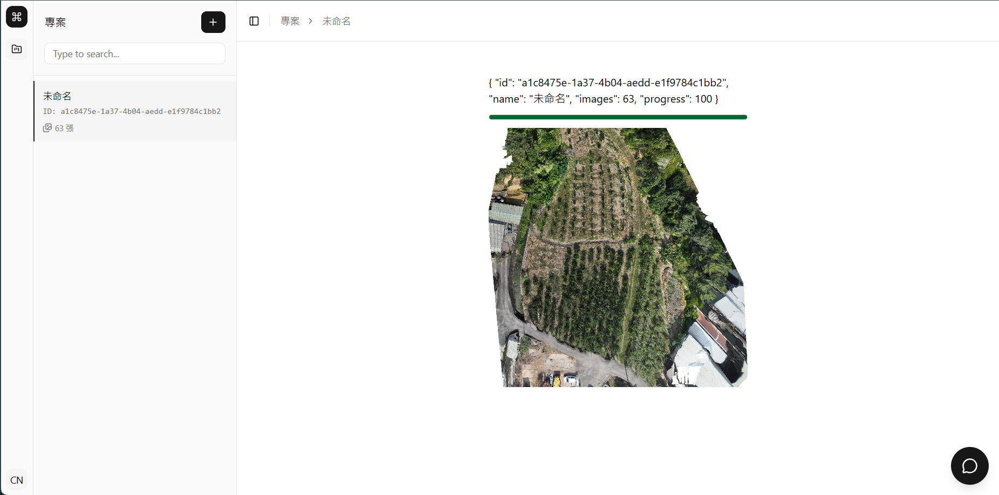

# 無人機田間試驗評估智慧代理人



## 人工智慧與資訊安全期末專題提案

> **專案期程**：2026 年 9 月 7 日 至 12 月 21 日  
> **核心定位**：以高解析度正射影像（地面取樣距離 [GSD](https://en.wikipedia.org/wiki/Ground_sample_distance) < 1 cm/px）為核心輸入，結合植保領域知識與確定性分析工具，由 AI Agent 評估田間試驗藥效並產出具可追溯證據之報告草稿。

### 章節目錄

| 編號 | 章節名稱 | 內容摘要 |
| :---: | :--- | :--- |
| 01 | [摘要 (Abstract)](docs/proposal/01_abstract.md) | 研究動機、產業痛點、解法架構與預期成效 |
| 02 | [緒論 (Introduction)](docs/proposal/02_introduction.md) | 田間試驗背景、現有限制與五大預期貢獻 |
| 03 | [相關文獻 (Related Work)](docs/proposal/03_related_work.md) | 農業多模態 AI / Agent、植生指標與法規文獻整理 |
| 04 | [深度探討 (Deep Research)](docs/proposal/04_deep_research.md) | 核心思維模式、關鍵爭論與技術 Q&A |
| 05 | [系統設計 (Proposed Scheme)](docs/proposal/05_proposed_scheme.md) | 系統架構圖、ReAct 調度流程與演算法虛擬碼 |
| 06 | [參考文獻 (References)](docs/proposal/06_references.md) | 22 篇論文文獻與 TACTRI / EPPO 法規標準 |

---

## 團隊成員分工

| 角色 | 成員 | 負責面向 |
| :--- | :--- | :--- |
| **Domain Lead（農業/植保）** | [@Kuonaiwei1126](https://github.com/Kuonaiwei1126) | 試驗資料與 Ground Truth、領域知識庫、評估指標設計、結果驗證 |
| **AI/System Lead（資訊/系統）** | [@ChengLiangHsu](https://github.com/ChengLiangHsu) | Agent 架構、影像分析工具、Tool 整合、GitHub、DESIGN.md |

---

## 專案啟動步驟

### 1. 環境需求
* **Python**：>= 3.13
* **uv**：Python 套件與環境管理工具

### 2. 啟動專案 (FastAPI)
1. **在專案根目錄安裝依賴套件**：
   ```bash
   uv sync
   ```
2. **設定環境變數**：
   於專案根目錄建立 `.env` 檔案並設定金鑰與模型：
   ```env
   PYDANTIC_AI_MODEL=google:gemini-3.7-flash
   GEMINI_API_KEY=your_gemini_api_key
   ```
3. **在專案根目錄啟動服務**：
   ```bash
   uv run fastapi dev src/main.py
   ```
---

## 航拍拼接服務 (NodeODM)

1. **安裝並啟動 Docker**。
2. **啟動 NodeODM 容器**：
   ```bash
   docker run --rm -p 3002:3000 opendronemap/nodeodm
   ```

---
