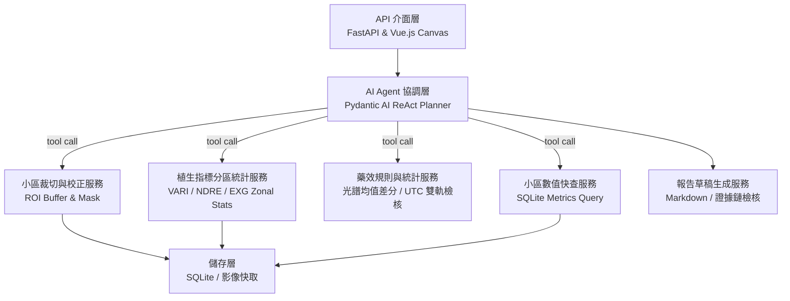
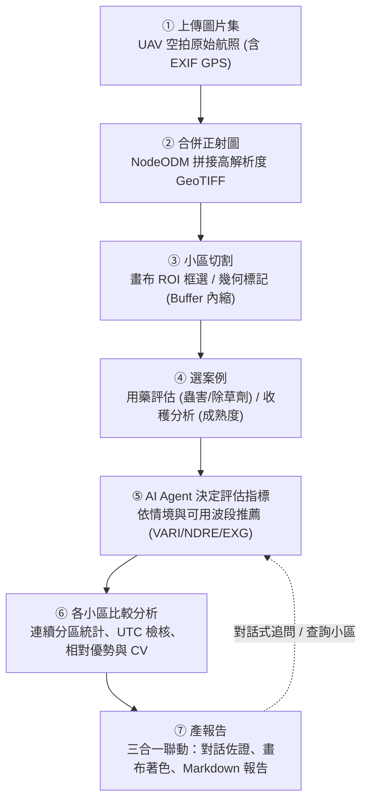
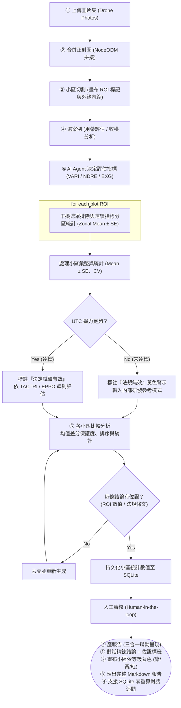

# 5. Proposed Scheme / Proposed Design

### 5.1 System Architecture

> **核心設計原則**：AI Agent 擔任 ReAct 專家調度指揮官，感知、空間分析與藥效計算交給確定性工具。

#### 系統分層架構 (System Architecture)

系統採用高內聚的模組化服務架構，明確劃分 API 介面、AI Agent 協調與確定性核心運算三大層次：

```text
API 介面層 (FastAPI + Vue.js) → AI Agent 協調層 (Pydantic AI ReAct Loop) → 核心功能服務層 (Segmentation / Indices / Rules)
```

| 層級 | 職責 | 主要內容 |
| :--- | :--- | :--- |
| **API 介面層 (API Layer)** | 提供 HTTP 與 REST API 端點，支援畫布互動標註與前端視覺聯動 | FastAPI 路由、Pydantic Schemas、畫布 ROI 座標與處理表對照傳遞 |
| **AI Agent 協調層 (Agent Layer)** | 意圖解析、動態 Tool Calling 編排與產出整合，擔任專案指揮官 | Pydantic AI Agent (ReAct 循環)、證據鏈檢核機制、小區指標查詢工具 |
| **核心功能服務層 (Core Services)** | 封裝專案核心能力的確定性計算與影像分區處理 | 畫布 ROI 裁切校正、連續植生指標分區統計 (VARI/NDRE/EXG)、藥效差分與 UTC 檢核 |
| **資料儲存層 (Storage Layer)** | 本機影像快取與小區統計數值持久化 | SQLite 資料庫（試驗歷程與小區分區數值快查）、正射影像檔案儲存 |



#### 功能架構



#### 各模組說明

| 模組 | 內容 | 技術選型（初步） |
| :--- | :--- | :--- |
| **① 上傳圖片集** | 試驗執行者上傳無人機空拍圖片集（含 GPS 經緯度 EXIF 資訊） | Vue.js 上傳元件、exifr、FastAPI 檔案接收 |
| **② 合併正射圖** | 調用 NodeODM 引擎自動進行空三解算與特徵點匹配，生成拼接正射影像 (GeoTIFF) | NodeODM、OpenDroneMap Docker 服務 |
| **③ 小區切割** | 於正射影像畫布上進行試驗小區手動框選 (ROI) 或載入幾何向量，自動內縮緩衝區 | Vue.js Canvas API、Pillow / rasterio 矩陣裁切 |
| **④ 選案例** | 使用者指定分析業務情境：農藥藥效試驗（殺蟲劑/除草劑）或田間生長收穫成熟度分析 | Web UI 案例選擇卡片、試驗設計處理表映射 |
| **⑤ AI Agent 決定指標** | Pydantic AI Agent 依選定案例目標與相機波段（RGB / 多光譜紅邊），動態檢索並推薦最適植生指標 | Pydantic AI ReAct Agent、領域知識庫 |
| **⑥ 各小區比較分析** | 干擾遮罩過濾、連續光譜分區統計 (Zonal Mean ± SE)、UTC 壓力雙軌檢核、相對保護度計算 | OpenCV、NumPy、rasterstats、Abbott 公式 |
| **⑦ 產報告** | 三合一聯動呈現：對話框條列結論與佐證、畫布小區著色 (綠/黃/紅)、一鍵匯出完整 Markdown 報告 | Vue.js 響應式渲染、SQLite 小區指標快查 |

#### 功能到程式模組的對應

| 功能 | 所在模組 | 說明 |
| :--- | :--- | :--- |
| 空拍圖上傳與任務管理 | `src/api/` | 接收航拍照片集、解析 GPS 資訊與建立正射拼接任務 |
| 正射拼圖服務封裝 | `src/utility/nodeodm.py` | 協調整合 NodeODM 容器執行正射影像自動拼接運算 |
| AI Agent 協調與推理 | `src/agent/` | Pydantic AI ReAct Agent 負責情境意圖解析、指標推薦與報告組裝 |
| 小區裁切與幾何校正 | `src/services/segmentation.py` | 根據畫布 ROI 裁切小區正射影像並執行外緣緩衝區內縮 |
| 植生指標分區統計運算 | `src/services/indices.py` | 執行 VARI、NDRE、EXG 矩陣運算與連續分區統計 (Zonal Mean ± SE) |
| 藥效規則與試驗檢核 | `src/services/trial_rules.py` | 確定性計算均值差分保護度、UTC 低壓雙軌判定與 CV 變異係數 |
| 報告生成與佐證產出 | `src/services/report_generator.py` | 彙整小區數值、裁切影像與佐證鏈，產出結構化 Markdown 報告草稿 |
| 資料庫與資料存取 | `src/database/` | SQLite 試驗紀錄與小區指標持久化，支援對話追問快查 |

---

### 5.2 Flowchart

> **核心決策原則**：對照組決定法定效力（低壓出具警示並轉內部參考），每條結論嚴格綁定證據鏈。



* **決策分支設計**：
  1. **UTC 壓力雙軌制**：若對照組未達危害門檻，不強制終斷程式，改出具黃色警示標註「不具法定效力」並繼續計算相對數值供內部參考。
  2. **證據鏈攔截**：候選結論必須嚴格具備小區編號、分區指標數值或試驗法規依據，否則直接攔截重試。
* **人機協同與即時追問**：小區分區數值存入 SQLite 後，使用者可直接點擊著色小區或在對話中追問（如「為何 T5 重複區變異大？」），Agent 透過查詢工具秒級回答。

---

### 5.3 Pseudocode

```python
Algorithm 1: 無人機田間試驗評估智慧代理人 (核心七階段 ReAct 協調流程)
Input:  Drone photos or orthomosaic I, canvas ROIs P, trial design D (treatments, UTC, blocks), user query Q
Output: Tripartite assessment (Chat summary, color-coded canvas, Markdown report R with evidence chain E)

// ① 上傳圖片集 & ② 合併正射圖
01: if input is drone photos then
02:     I = nodeodm_stitch(drone_photos)            // NodeODM 自動空三拼接生成高解析度 GeoTIFF
03: end if

// ③ 小區切割 & ④ 選案例
04: P = canvas_roi_segmentation(I, buffer = 0.5 m)  // 畫布 ROI 框選/幾何標記，自動內縮緩衝區
05: scenario = parse_case(Q, D)                     // 用藥評估 (蟲害/除草劑) 或 收穫分析 (成熟度)

// ⑤ AI Agent 決定評估指標
06: indices, rules = Agent.decide_indices(scenario, I.camera_bands) // RGB 推薦 VARI/EXG；紅邊推薦 NDRE

// ⑥ 各小區比較分析 (分區統計、對照檢核與相對優勢)
07: for each plot roi in P:
08:     tile_p = rectify_tile(I, roi)
09:     mask_p = interference_mask(tile_p)          // 水面/青苔/陰影排除
10:     f_p    = zonal_statistics(tile_p, mask_p, indices) // 連續分區統計: Mean ± SE
11: end for

12: F = aggregate(f_p by D.treatment, D.block)      // 各處理組重複區平均值與 CV 變異係數
13: if F[UTC].pressure < rules.min_pressure then
14:     flag_warning("UTC pressure insufficient: regulatory invalid, continuing for internal reference")
15: end if

16: eff  = rules.calculate_relative_protection(F, UTC) // 連續光譜均值差分保護度 (%)
17: rank = order_treatments_by_efficacy(eff)

// ⑦ 產報告 (證據鏈檢核、持久化與三合一呈現)
18: cand = Agent.generate_candidates(rank, F, rules) // 條列各處理結論
19: for each c in cand: verify_evidence(c, E)       // 檢核每條結論均綁定 ROI 數值或法規條文
20: R    = compose_markdown_report(cand, eff, rules.report_template)
21: persist_plot_metrics_to_sqlite(F, eff, D)        // 寫入 SQLite 支援後續秒級追問
22: present_tripartite(dialog_summary = cand, canvas_overlay = color_code(P, eff), report = R, evidence = E)
23: return R
```

#### 設計重點
* **01–03 行（步驟 ①②）**：無縫支援原始航照自動拼圖（NodeODM）或直接載入已拼接正射影像，兼顧靈活性與即時性。
* **04–06 行（步驟 ③④⑤）**：畫布標註後，由 Pydantic AI Agent 依選定案例與相機波段（RGB / 多光譜）動態檢索並決定最適指標。
* **07–17 行（步驟 ⑥）**：連續光譜分區統計（Zonal Mean ± SE）與 UTC 雙軌判定，完全由純 Python 確定性工具運算，杜絕數值估算幻覺。
* **18–23 行（步驟 ⑦）**：通過嚴格證據鏈檢核後，小區數據寫入 SQLite，並以「對話精鍊結論 + 畫布著色 + Markdown 報告」三合一聯動呈現。

---

### 5.4 Technical Feasibility

| 項目 | 現況 | 風險 / 對策 |
| :--- | :--- | :--- |
| **資料** | 4RL（水稻害蟲）、Concil（除草劑）正射影像與 ground truth 已在手（$\text{GSD } 0.85 \sim 0.9\text{ cm}$） | 資料來源為公司試驗，需去識別化後放 GitHub；或只公開小區級指標 |
| **空間標註與影像** | 前端 Canvas 支援手動框選小區 ROI 與指派處理，後端支援緩衝區內縮與水面/陰影遮罩 | 邊緣效應干擾 $\rightarrow$ 前端標註後後端自動內縮 $0.5 \sim 1\text{ m}$ 緩衝區排除邊緣植株 |
| **指標演算法** | 採用連續光譜指標分區統計（Zonal Mean ± SE）運算，不依賴重型實例分割模型 | 運算負擔輕、本機秒級即時完成，無 GPU 訓練維護負擔 |
| **LLM / Agent** | 採用 Pydantic AI 實作 ReAct Tool-Calling 專家循環，小區數值寫入 SQLite 支援即時追問 | 若追問查詢負擔重 $\rightarrow$ 透過 SQLite 專屬查詢工具直接調取分區數值，零重複影像 I/O |
| **統計與判定** | 以各處理分區平均值相對於 UTC 之均值差分計算保護度，落實低壓雙軌警示機制 | 3 重複檢定力較低 $\rightarrow$ 系統主動標註 CV 變異係數與試驗不確定性說明 |
| **時程** | 10 月 proposal $\rightarrow$ 11 月工具鏈 $\rightarrow$ 12 月 agent 整合與實驗 $\rightarrow$ 1 月 handover | 兩人分工明確（見第 6 節） |

