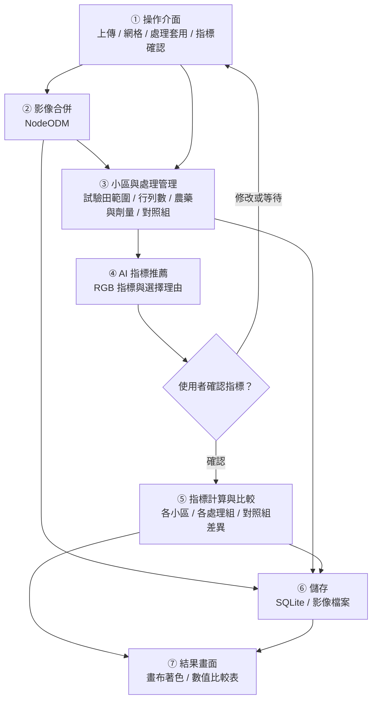
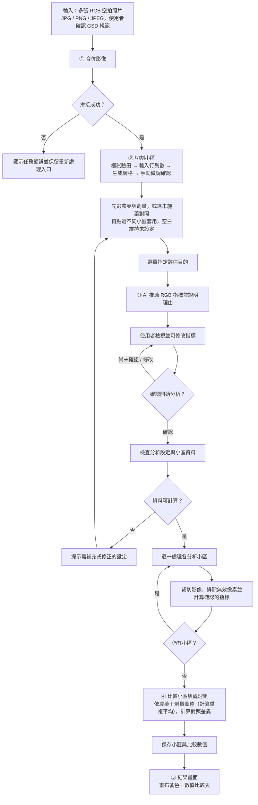

# 5. Proposed Scheme / Proposed Design

> **第一版目標**：先完成農藥試驗的影像指標比較流程，以畫布著色與數值比較表呈現結果，流程跑通後才開始實作收穫分析。
> **後續範圍**：AI 結果摘要、報告生成與匯出延後，人工調查、正式藥效百分比及法定效力判定另行確認。

### 5.1 System Architecture

#### 系統分層架構

- **介面層**：使用 [Vue.js](https://vuejs.org/) 與 [Canvas API](https://developer.mozilla.org/en-US/docs/Web/API/Canvas_API) 操作影像，透過 [FastAPI](https://fastapi.tiangolo.com/) 傳遞小區與分析設定。
- **AI 協調層**：使用 [Pydantic AI](https://ai.pydantic.dev/tools/) 推薦可用指標並說明理由，使用者可修改，明確確認後才啟動分析。
- **確定性運算層**：使用 [NodeODM](https://github.com/OpenDroneMap/NodeODM) 合併照片，以 [NumPy](https://numpy.org/doc/stable/)、[Rasterio](https://rasterio.readthedocs.io/en/stable/) 與 [rasterstats](https://pythonhosted.org/rasterstats/) 完成網格、指標及分區比較。
- **儲存層**：以 [SQLite](https://www.sqlite.org/docs.html) 保存小區、處理設定與計算結果，影像另外存為檔案。



#### 各模組職責

| 模組 | 第一版責任 | 參考 |
| :--- | :--- | :--- |
| **① 操作介面** | 接收多張 RGB 照片，提供網格設定、處理套用與指標確認操作 | [Vue.js](https://vuejs.org/)、[Canvas](https://developer.mozilla.org/en-US/docs/Web/API/Canvas_API) |
| **② 影像合併** | 將照片交給 NodeODM 拼接，取得正射影像後進入小區設定 | [NodeODM API](https://github.com/OpenDroneMap/NodeODM)、[ODM 輸出](https://docs.opendronemap.org/outputs/) |
| **③ 小區與處理管理** | 依試驗田範圍及行列數生成網格，允許微調，再以點選方式套用農藥與劑量或未施藥對照 | [等距分點](https://numpy.org/doc/stable/reference/generated/numpy.linspace.html)、[點選範圍判斷](https://developer.mozilla.org/en-US/docs/Web/API/CanvasRenderingContext2D/isPointInPath) |
| **④ AI 指標推薦** | 依使用者從選單指定的評估目的，推薦 RGB 可計算的指標與理由，使用者可修改後確認 | [Pydantic AI 工具](https://ai.pydantic.dev/tools/)、[VARI](https://step.esa.int/main/wp-content/help/versions/13.0.0/snap-toolboxes/eu.esa.opt.opttbx.radiometric.indices.ui/vari/VariAlgorithmSpecification.html)、[ExG 文獻](https://elibrary.asabe.org/abstract.asp?aid=27838) |
| **⑤ 指標計算與比較** | 計算各小區指標，依「農藥＋劑量」分組並計算重複小區平均值（典型為 3 重複），並比較明確指定對照組的指標差異 | [Rasterio](https://rasterio.readthedocs.io/en/stable/)、[分區統計](https://pythonhosted.org/rasterstats/) |
| **⑥ 儲存** | 保存網格、小區處理設定、確認的指標及計算結果，保留小區編號與數值來源 | [SQLite](https://www.sqlite.org/docs.html) |
| **⑦ 結果畫面** | 在同一結果頁提供依指標數值著色的畫布及數值比較表 | [Canvas](https://developer.mozilla.org/en-US/docs/Web/API/Canvas_API) |

#### 操作規則

- **輸入規格**：上傳多張 RGB 空拍照片，格式限定為 JPG、PNG 或 JPEG，GSD < 1 cm/px 作為由使用者確認的資料準備規範，第一版不以系統自動檢核 GSD 作為拒絕分析的條件（[GSD 定義](https://en.wikipedia.org/wiki/Ground_sample_distance)）。
- **網格切割**：使用者框出試驗田並輸入行列數，系統生成小區網格後允許手動微調與確認。
- **處理套用**：先選好農藥與施用劑量，再依序點選不同小區套用，以「農藥＋劑量」區分處理組；系統彈性支援多小區重複（建議與典型為 3 重複配置）。
- **未施藥對照**：對照組與處理組採用相同的小區規劃及點選套用方式，以 CK 或 UTC 明確標記未施藥對照且不填農藥與劑量，空白僅代表尚未設定。
- **指標確認**：使用者從選單指定評估目的（例如殺蟲劑或除草劑），AI 顯示推薦指標與理由，使用者可修改，明確確認後才計算。
- **比較依據**：第一版僅比較 RGB 影像指標，例如 [VARI](https://step.esa.int/main/wp-content/help/versions/13.0.0/snap-toolboxes/eu.esa.opt.opttbx.radiometric.indices.ui/vari/VariAlgorithmSpecification.html) 與 [ExG](https://elibrary.asabe.org/abstract.asp?aid=27838)，原列 NDRE 移出本階段範圍。
- **結果內容**：比較表列出各小區編號、農藥、劑量、對照狀態及指標數值（保留完整明細），並提供各處理組去平均計算之平均值（Treatment Mean）與對照組差異，畫布顏色代表指標數值高低。
- **差異核對**：採雙軌解讀機制。相同農藥與劑量的小區出現明顯指標差異時，總體表現以 3 重複平均值為基準以平抑田間自然變異，同時保留各小區原始結果，由使用者回看影像與設定以釐清局部干擾原因，不擅自剔除異常小區（[NIST 異常觀測處理原則](https://www.itl.nist.gov/div898/handbook/eda/section3/eda35h.htm)；[田間試驗設計指南](https://extension.umn.edu/courses-and-events/for-professionals/on-farm-research/how-to-do-research-on-your-farm)）。

#### 功能與程式模組對應

以下是依現有目錄安排的責任規劃，不表示各功能已完成實作。

| 功能 | 模組位置 | 規劃責任 |
| :--- | :--- | :--- |
| 應用程式入口 | `src/main.py` | 僅建立應用程式、管理生命週期與掛載控制器 |
| 上傳與拼接任務 | `src/controllers/odm.py`、`src/utility/nodeodm.py` | 分別處理請求與 NodeODM 任務協調 |
| 串流進度管理 | `src/controllers/odm.py`、`frontend/src/lib/useOdmProgress.ts` | 以 SSE 串流即時推播拼圖進度與前端響應式綁定 |
| AI 指標推薦與對話 | `src/controllers/conversation.py`、`src/agents/pydantic_agent.py` | 接收試驗設定、推薦指標、提供理由與來源，遵守使用者確認流程 |
| 網格繪製與點選 | `frontend/src/App.vue` (Canvas API) | 前端畫布互動框選、等距網格生成、微調與點選套用處理組 |
| 指標與影像運算 | `src/utility/formulas.py`、`src/utility/spectral.py` | 管理公式及執行影像指標運算，擴充分區統計與處理組比較 |
| 資料存取 | `src/database.py` | 集中保存任務、小區網格幾何、處理設定與分析結果 |
| 前端呈現 | `frontend/src/App.vue` | 提供畫布著色疊加圖、圖例與雙向連動數值比較表 |

---

### 5.2 Flowchart



- **人工確認**：指標推薦與指標計算之間保留明確確認點，未確認時不執行小區分析。
- **資料區分**：未設定小區與未施藥對照分開記錄，缺少必要資料時顯示待補充原因，不自動補成對照組或捏造數值。
- **數值來源**：畫布與比較表使用同一批計算結果，保留小區編號、處理設定及指標名稱以便核對。

---

### 5.3 Pseudocode

```text
Algorithm 1: RGB 空拍小區指標比較與可重現評估
Input : 
    H   : 使用者上傳之 RGB 空拍照片集 (JPG/PNG/JPEG, GSD < 1cm)
    B   : 使用者框選之試驗田外邊界幾何多邊形
    G   : 網格行列維度 (rows, cols)
    T   : 處理組選項集 { (pesticide_1, dose_1), ... }
    UTC : 未施藥對照組 (CK)
    S   : 使用者指定之評估目的 (如殺菌、除草、生理逆境)
Output: 
    V   : 依指標數值著色之畫布疊加層 (Plot Color Overlay)
    C   : 小區明細與處理組彙整比較表 (Comparison Tables)

01: I = stitch_orthophoto_via_nodeodm(H)
02: P_raw = generate_regular_grid(B, G)
03: P = interactive_canvas_adjust_and_confirm(I, P_raw)
04: D = assign_treatments_by_user_clicks(P, T, UTC)
05: K = query_supported_rgb_indices()
06: A = PydanticAgent.recommend_indices(S, K)
07: J = wait_for_user_explicit_confirmation(A)
08: validate_spatial_and_treatment_inputs(I, P, D, J)
09: for each plot p in P do:
10:     pixels_p = extract_masked_roi_pixels(I, p)
11:     F[p] = calculate_zonal_spectral_metric(pixels_p, J)
12: end for
13: C_treatments = aggregate_treatment_means(F, D)  // 計算各「農藥＋劑量」組平均值
14: C_diff = compute_differences_against_control(C_treatments, UTC)
15: persist_trial_results_to_sqlite(P, D, J, F, C_treatments, C_diff)
16: V = render_color_coded_canvas_overlay(P, F, J)
17: return V, C_treatments, C_diff
```

- **主流程調度模式**：主函式僅負責協調整體執行流程與調度子函式，深層業務邏輯封裝於單一職責子模組中。
- **第 01–04 行**：NodeODM 拼圖完成後，使用者於前端畫布框選田界、生成網格並手動微調，點選指派「農藥＋劑量」或「未施藥對照 (UTC)」，未指派小區維持空白。
- **第 05–08 行**：Pydantic AI 代理人依評估目的推薦 RGB 適用指標（VARI、ExG）並詳述物理理由；經使用者於前端彈窗明確確認後，方啟動資料驗證。
- **第 09–12 行**：逐小區萃取有效植被像素（排除裸土背景），透過純函式計算分區光譜指標統計值。
- **第 13–17 行**：依試驗規範計算同處理 3 重複小區平均值（Treatment Mean）與對照組差異，寫入 SQLite 持久化保存，並於前端畫布同步呈現著色熱圖與雙向可溯數值表。

---

### 5.4 Technical Feasibility

| 項目 | 可行性依據 | 待驗證事項 |
| :--- | :--- | :--- |
| **影像輸入與合併** | 已有多張 RGB 空拍照片，可透過 [NodeODM](https://github.com/OpenDroneMap/NodeODM) 產生 [正射影像](https://docs.opendronemap.org/outputs/) | 以實際照片確認 GPS 資訊、拼接成功率與處理時間 |
| **網格與點選操作** | [Canvas](https://developer.mozilla.org/en-US/docs/Web/API/Canvas_API) 與 [等距座標](https://numpy.org/doc/stable/reference/generated/numpy.linspace.html) 可作為畫布及網格的實作基礎 | 驗證網格微調、農藥與劑量套用、未施藥對照及空白狀態 |
| **AI 指標推薦** | [Pydantic AI](https://ai.pydantic.dev/tools/) 可連接指標查詢工具，搭配固定的公式與參考來源 | 驗證推薦可計算、理由有來源、使用者修改及確認流程 |
| **指標與比較運算** | [VARI](https://step.esa.int/main/wp-content/help/versions/13.0.0/snap-toolboxes/eu.esa.opt.opttbx.radiometric.indices.ui/vari/VariAlgorithmSpecification.html)、[ExG](https://elibrary.asabe.org/abstract.asp?aid=27838) 與 [分區統計](https://pythonhosted.org/rasterstats/) 提供公式及計算依據 | 以實際影像核對小區數值、有效像素與對照差異，量測執行時間 |
| **結果保存與呈現** | [SQLite](https://www.sqlite.org/docs.html) 保存結果，由前端共用同一批數值呈現畫布及表格 | 核對小區編號、處理組、著色圖例與表格數值一致 |
