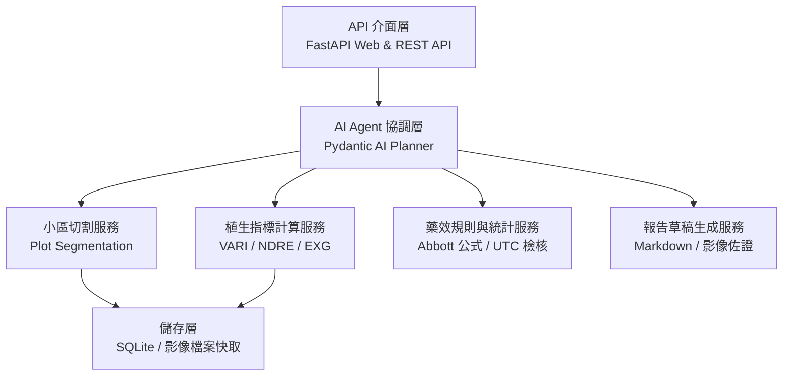
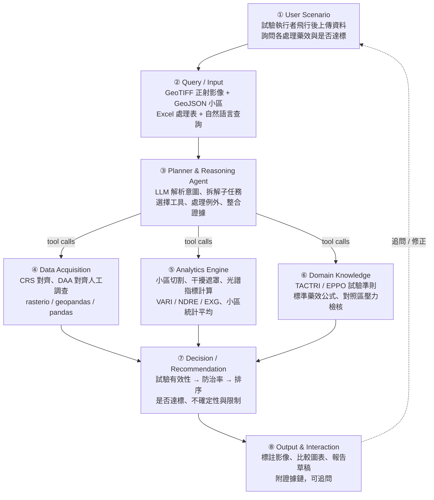
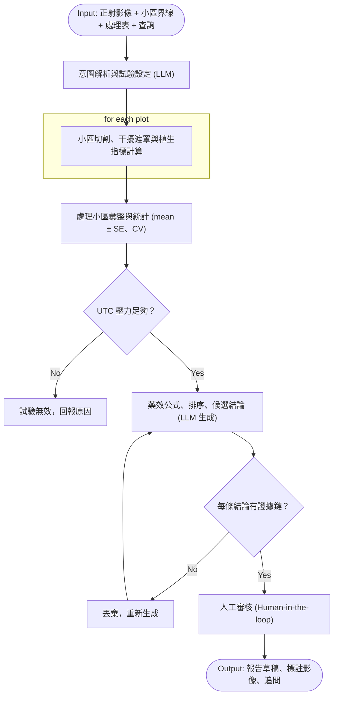

# 5. Proposed Scheme / Proposed Design

### 5.1 System Architecture

> **核心設計原則**：LLM 擔任 planner，感知與計算交給確定性工具。

#### 系統分層架構 (System Architecture)

系統採用高內聚的模組化服務架構，明確劃分 API 介面、AI Agent 協調與確定性核心運算三大層次：

```text
API 介面層 (FastAPI) → AI Agent 協調層 (Pydantic AI) → 核心功能服務層 (Segmentation / Indices / Rules)
```

| 層級 | 職責 | 主要內容 |
| :--- | :--- | :--- |
| **API 介面層 (API Layer)** | 提供 HTTP 與 REST API 端點，負責資料輸入驗證與前端互動 | FastAPI 路由、請求與回應資料結構 (Pydantic Schemas)、檔案上傳處理 |
| **AI Agent 協調層 (Agent Layer)** | 意圖解析、工具調度與產出整合，擔任專案的 Planner | Pydantic AI Agent、Prompt 模板、工具調度與證據鏈檢核 |
| **核心功能服務層 (Core Services)** | 封裝專案三大核心能力的確定性計算與影像處理 | 小區切割 (Plot Segmentation)、植生指標計算 (VARI/NDRE/EXG)、藥效規則與統計 (Abbott/UTC 檢核) |
| **資料儲存層 (Storage Layer)** | 本機影像快取與資料庫儲存 | SQLite 資料庫、正射影像與小區裁切圖儲存 |



#### 功能架構



#### 各模組說明

| 模組 | 內容 | 技術選型（初步） |
| :--- | :--- | :--- |
| **① User/Application Scenario** | 試驗執行者在飛行後上傳正射影像與試驗設計，詢問「各處理對縱捲葉蟲的防治效果如何？是否達登記標準？」 | Web UI + FastAPI 端點 |
| **② Query/Input** | 自然語言查詢 + GeoTIFF 正射影像（RGB/多光譜）+ GeoJSON 小區界線 + Excel 處理表與人工調查資料 | FastAPI schema；rasterio、geopandas、openpyxl |
| **③ Planner & Reasoning Agent** | 解析目標並編排流程；Pydantic AI 實作模型呼叫與 tool calling，領域例外由確定性規則判定 | Pydantic AI、LLM (Claude / GPT / 本地 Qwen2.5-VL) |
| **④ Data Acquisition / Retrieval** | 讀取影像與向量檔、對齊 CRS、以 DAA 對齊人工調查 | rasterio / GDAL、pandas |
| **⑤ Analytics Engine** | 小區切割與校正（外緣 buffer）、干擾遮罩（青苔/陰影/水面）、光譜指標計算（ExG、VARI、NDRE 等）與小區平均統計 | OpenCV、NumPy、PIL、rasterio |
| **⑥ Domain Knowledge Integration** | 試驗法規準則：TACTRI 田間試驗準則、EPPO PP 1/152、標準藥效公式（Abbott、Henderson-Tilton、防治率）與對照區壓力檢核 | Python 確定性規則與計算函式 |
| **⑦ Decision / Recommendation** | 試驗有效性判定 $\rightarrow$ 各處理防治率與排序 $\rightarrow$ 是否達標 $\rightarrow$ 不確定性與限制說明 | LLM 整合 + 固定模板；證據鏈（ROI、數值、公式、條文） |
| **⑧ Output & Interaction** | 小區級標註影像、處理比較圖表、報告草稿（Markdown / DOCX）、可追問（「為何 T5 排第二？」） | matplotlib / folium、python-docx；對話式追問 |

#### 功能到程式模組的對應

| 功能 | 所在模組 | 說明 |
| :--- | :--- | :--- |
| API 路由與資料檢核 | `src/api/` | 處理正射影像上傳、試驗小區輸入與前端互動 |
| AI Agent 協調與推理 | `src/agent/` | Pydantic AI Agent 負責解析試驗需求與調度工具 |
| 小區切割與幾何校正 | `src/services/segmentation.py` | 根據網格界線切割小區正射影像並做緩衝區校正 |
| 植生指標矩陣運算 | `src/services/indices.py` | 執行 VARI、NDRE、EXG 矩陣運算與水面/陰影遮罩 |
| 藥效公式與試驗規則 | `src/services/trial_rules.py` | 確定性計算 Abbott 藥效公式、UTC 壓力檢核與統計 |
| 報告生成與佐證產出 | `src/services/report_generator.py` | 彙整數值與裁切影像，產出具證據鏈的報告草稿 |
| 資料庫與資料存取 | `src/database/` | SQLite 試驗紀錄與小區指標持久化 |

---

### 5.2 Flowchart

> **對照組壓力不足或缺少證據鏈，流程就停下來。**



* **兩個決策點**：對應 Pseudocode 第 12 行（UTC 壓力）與第 19 行（證據鏈驗證）。
* **人工審核**：在輸出前保留 Human-in-the-loop，符合登記試驗的責任歸屬。

---

### 5.3 Pseudocode

```python
Algorithm 1: 無人機田間試驗評估智慧代理人
Input:  User query Q, orthomosaic I (GeoTIFF), plot boundaries P (GeoJSON),
        trial design D (treatments, blocks, DAA), optional ground truth G
Output: Efficacy assessment report R with evidence chain E

01: Receive Q, I, P, D, (G)
02: intent = LLM.parse_intent(Q)                // target: weed | insect; metric asked
03: type = D.trial_type; design = D.layout      // e.g., RCBD, 8 trt × 3 rep
04: rules = get_trial_rules(type, intent)       // TACTRI/EPPO clauses, Abbott formula, CV threshold
05: I, P = align_crs(I, P); check GSD <= 1 cm else warn

06: for each plot p in P:
07:     tile_p = rectify(I, p, buffer = 1 m)
08:     mask_p = interference_mask(tile_p)      // algae/shadow/water; NDRE cross-check
09:     f_p    = calculate_indices(tile_p, mask_p) // VARI, NDRE, EXG, coverage %
10: end for

11: F = aggregate(f_p by D.treatment, D.block)  // mean ± SE per treatment; block effect
12: if F[UTC].pressure < rules.min_pressure then
13:     return R = "Trial invalid: insufficient pressure in UTC", E
14: end if

15: eff = rules.calculate_efficacy(F, UTC)      // Abbott / Henderson-Tilton
16: cv = calculate_cv(F); stats = summary_stats(F)
17: if cv > rules.max_cv then flag "high variability"
18: rank = order_treatments_by_efficacy(eff)

19: cand = LLM.generate_candidates(rank, stats, rules)   // conclusions per treatment
20: for each c in cand: verify(c, E)                     // every claim must cite ROI / value / clause
21: unc = uncertainty(single DAA, mask coverage, cv)
22: R = LLM.compose_report(cand, unc, rules.report_template)
23: present(R, annotated_map(I, P, F), charts, E)
24: return R
```

#### 設計重點
* **第 02, 19, 22 行**：是 LLM 的工作（理解、整合、表達）；其餘行數全部是確定性工具，LLM 不得自行估算數值。
* **第 12–14 行**：把「對照組決定一切」的思維寫進流程：UTC 壓力不足即停止。
* **第 20 行**：幻覺攔截機制：沒有證據鏈的候選結論會被直接丟棄。
* **確定性計算**：藥效計算與指標統計皆由 Python 程式確定性計算，徹底杜絕檢索漂移與模型計算誤差。

---

### 5.4 Technical Feasibility

| 項目 | 現況 | 風險 / 對策 |
| :--- | :--- | :--- |
| **資料** | 4RL（水稻害蟲）、Concil（除草劑）正射影像與 ground truth 已在手（$\text{GSD } 0.85 \sim 0.9\text{ cm}$） | 資料來源為公司試驗，需去識別化後放 GitHub；或只公開小區級指標 |
| **影像方法** | 小區切割、ExG-brightness、ROI 排除、VARI / NDRE 指標已驗證可行 | 捲葉在 RGB 的可辨識度未知 $\rightarrow$ 先以 42 DAA 影像做可行性評估 |
| **指標演算法** | 植生指標與干擾遮罩採用成熟矩陣計算（NumPy/PIL），不依賴重型標註模型 | 運算負擔輕、可本機即時執行，無需複雜 GPU 訓練管線 |
| **LLM / Agent** | 採用雲端 API（Gemini / Claude）或本地輕量模型進行意圖拆解與報告生成 | 本地模型推理能力若不足 $\rightarrow$ planner 用 API，工具保持本地運行 |
| **統計與判定** | 以小區平均值、標準差與標準 Abbott 公式確定性計算 | 3 重複檢定力較低 $\rightarrow$ 報告中明示限制與不確定性 |
| **時程** | 10 月 proposal $\rightarrow$ 11 月工具鏈 $\rightarrow$ 12 月 agent 整合與實驗 $\rightarrow$ 1 月 handover | 兩人分工明確（見第 6 節） |
