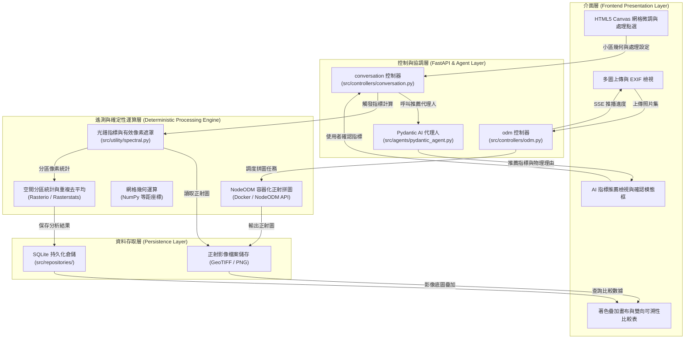

# 系統設計規格書 (DESIGN.md)

本文件嚴格依據課程規範 [COURSE.md](docs/proposal/COURSE.md#L184) 之最低要求撰寫，涵蓋 9 大核心項目：**Architecture**、**Components**、**Data Flow**、**AI Model**、**Domain Knowledge**、**Algorithm**、**Implementation Mapping**、**Results**、**Limitations**。

---

## 1. Architecture (系統架構)

系統採用服務導向之分層架構（Service-Oriented Layered Architecture），確保介面互動、AI 調度、影像遙測與資料儲存之高內聚與低耦合：



- **介面層**：以 [Vue.js](https://vuejs.org/) 與 [HTML5 Canvas API](https://developer.mozilla.org/en-US/docs/Web/API/Canvas_API) 提供影像檢視、互動式網格框選與小區微調，並以 [Server-Sent Events (SSE)](https://developer.mozilla.org/en-US/docs/Web/API/Server-sent_events) 即時接收拼圖進度。
- **控制與協調層**：以 [FastAPI](https://fastapi.tiangolo.com/) 集中路由調度，並透過 [Pydantic AI](https://ai.pydantic.dev/) 代理人依據試驗情境推薦合適之光譜指標與解說物理理由。
- **確定性運算層**：透過容器化 [NodeODM](https://github.com/OpenDroneMap/NodeODM) 執行攝影測量正射影像拼接，並以 [NumPy](https://numpy.org/)、[Rasterio](https://rasterio.readthedocs.io/en/stable/) 與 [Rasterstats](https://pythonhosted.org/rasterstats/) 執行像素遮罩與空間分區統計。
- **資料存取層**：採用 [SQLModel](https://sqlmodel.tiangolo.com/) 與 [SQLite](https://www.sqlite.org/docs.html) 保存任務紀錄、小區座標與計算成果。

---

## 2. Components (模組元件職責)

各程式模組嚴格遵循單一職責原則（Single Responsibility Principle）：

| 模組檔案 | 職責定義 | 依賴技術 |
| :--- | :--- | :--- |
| [`src/main.py`](src/main.py) | 應用程式進入點，初始化 FastAPI、設定 CORS、管理生命週期與掛載控制器路由 | [FastAPI](https://fastapi.tiangolo.com/) |
| [`src/controllers/odm.py`](src/controllers/odm.py) | 處理照片上傳、建立 NodeODM 任務、提供 SSE 串流端點 (`/api/odm-task-stream`) | [FastAPI StreamingResponse](https://fastapi.tiangolo.com/advanced/custom-response/) |
| [`src/controllers/conversation.py`](src/controllers/conversation.py) | 接收前端試驗設定，調度 Pydantic AI Agent 與執行結果查詢 | [FastAPI APIRouter](https://fastapi.tiangolo.com/tutorial/bigger-applications/) |
| [`src/agents/pydantic_agent.py`](src/agents/pydantic_agent.py) | 定義 Pydantic AI Agent、System Prompt、指標推薦 Tools 與型別驗證模型 | [Pydantic AI](https://ai.pydantic.dev/) |
| [`src/utility/spectral.py`](src/utility/spectral.py) | 實作 VARI、ExG 光譜矩陣純函數運算與背景土壤/水面遮罩生成 | [NumPy](https://numpy.org/)、[Pillow](https://pillow.readthedocs.io/) |
| [`src/utility/formulas.py`](src/utility/formulas.py) | 集中管理光譜公式定義、物理現象解說字典與對照組差異計算邏輯 | Python 標準庫 |
| [`src/utility/nodeodm.py`](src/utility/nodeodm.py) | 封裝 NodeODM HTTP REST API 通訊（新建任務、狀態輪詢、下載結果） | [httpx](https://www.python-httpx.org/) |
| [`src/usecases/`](src/usecases/) | 封裝應用層業務流程（OdmUseCase 任務管理、ConversationUseCase 串流），解耦傳輸與核心邏輯 | Clean Architecture |
| [`src/repositories/`](src/repositories/) | 集中管理 SQLite 連線、SQLModel 資料表模型映射與專責倉儲持久化操作 | [SQLModel](https://sqlmodel.tiangolo.com/)、[SQLite](https://www.sqlite.org/) |
| [`src/entities/`](src/entities/) | 定義純 Python Dataclass 領域資料物件（Project, PlotGrid, Message），無外部依賴 | Python 標準庫 |
| [`frontend/src/App.vue`](frontend/src/App.vue) | 單一頁面主視圖，整合上傳、Canvas 網格微調、農藥套用、指標確認與比較表 | [Vue 3](https://vuejs.org/)、[Canvas API](https://developer.mozilla.org/en-US/docs/Web/API/Canvas_API) |
| [`frontend/src/lib/useOdmProgress.ts`](frontend/src/lib/useOdmProgress.ts) | 獨立 Vue Composable，專責管理 EventSource SSE 連線、狀態解析與資源釋放 | [WHATWG EventSource](https://developer.mozilla.org/en-US/docs/Web/API/EventSource) |

---

## 3. Data Flow (資料流向與模型)

### 3.1 核心資料流向
1. **上傳與拼圖**：前端上傳多張 RGB 照片 $\rightarrow$ 後端傳遞至 NodeODM 容器 $\rightarrow$ NodeODM 輸出 `orthophoto.tif` $\rightarrow$ 透過 SSE 推送完成事件。
2. **小區標註**：前端載入正射圖底圖 $\rightarrow$ 使用者繪製邊界並指定行列 $\rightarrow$ 前端計算小區多邊形頂點 $\rightarrow$ 使用者點選指派「處理描述」或「對照組 (CK)」。
3. **AI 推薦與確認**：使用者指定試驗評估目的 $\rightarrow$ 後端傳遞至 Pydantic AI Agent $\rightarrow$ Agent 推薦指標並說明物理理由 $\rightarrow$ 前端彈出確認框 $\rightarrow$ 使用者明確確認。
4. **指標計算與比較**：後端呼叫 `spectral.py` 讀取小區內像素 $\rightarrow$ 計算植生指標矩陣 $\rightarrow$ 依處理組計算 3 重複平均值 $\rightarrow$ 存入 SQLite $\rightarrow$ 前端呈現著色畫布與比較表。

### 3.2 資料庫實體模型 (Database Schema)
* **TrialTask (試驗任務)**：`id`, `task_name`, `status`, `orthophoto_path`, `created_at`
* **PlotGrid (小區網格)**：`id`, `task_id`, `plot_number`, `polygon_coords`, `pesticide_name`, `dose`, `is_control`
* **MetricResult (指標結果)**：`id`, `plot_id`, `index_name`, `mean_value`, `min_value`, `max_value`, `treatment_mean`, `diff_from_control`

---

## 4. AI Model (AI 模型代理人)

### 4.1 Pydantic AI 協調機制
* **模型與架構定位**：採用基於 [Pydantic AI](https://ai.pydantic.dev/) 的領域代理人（Domain AI Agent）架構，後端支援串接大型語言/多模態模型（如 Gemini、Claude 等）。
* **職責純粹性**：AI 模型不負責執行高負載的影像幾何切割或光學矩陣計算，專責理解使用者試驗目的、調用可用指標查詢工具，並以結構化格式輸出具備物理依據的指標推薦。
* **推薦資料結構 (Structured Output)**：
  ```python
  class IndexRecommendation(BaseModel):
      index_name: str = Field(description="推薦的植生指標名稱，如 VARI 或 ExG")
      formula: str = Field(description="光譜計算公式")
      reasoning: str = Field(description="依據試驗目的所提供的生理現象判讀理由")
      reference: str = Field(description="權威科學文獻來源連結")
  ```
* **防脫軌提示詞約束**：嚴格約束 AI 模型僅能由系統內建之 RGB 指標清單中進行挑選，嚴禁推薦無對應波段之多光譜指標（如 NDRE）。

### 4.2 確定性光譜運算支援
1. **可見光大氣阻抗指標 (VARI)**：
   $$\text{VARI} = \frac{R_{\text{Green}} - R_{\text{Red}}}{R_{\text{Green}} + R_{\text{Red}} - R_{\text{Blue}}}$$
   *物理意涵*：量化作物冠層綠度活力，對大氣氣膠與散射具有自校正能力（[Gitelson et al., 2002](https://doi.org/10.1016/S0034-4257(01)00318-2)）。
2. **過綠指標 (ExG)**：
   $$\text{ExG} = 2g - r - b, \quad \text{其中 } r=\frac{R}{R+G+B}, \; g=\frac{G}{R+G+B}, \; b=\frac{B}{R+G+B}$$
   *物理意涵*：強化綠色植被反射特徵，有效分離裸土、落葉與背景陰影雜訊（[Woebbecke et al., 1995](https://elibrary.asabe.org/abstract.asp?aid=27838)）。

---

## 5. Domain Knowledge (領域知識整合)

系統將農業植保與田間試驗學科規範轉化為確定性的軟體邏輯：

1. **空間異質性與重複試驗 (Replications)**：
   農田存在土壤肥力與微地形之天然異質性。依據 [EPPO PP 1/152](https://www.eppo.int/RESOURCES/eppo_standards/standards_pp1) 標準，系統強制支援 3 至 4 次重複配置，以同組「處理＋劑量」之小區去平均值（Treatment Mean）作為統計基準：
   $$\text{Treatment Mean} = \frac{1}{N} \sum_{i=1}^{N} \text{Metric}_{\text{Plot}_i}$$
2. **小區邊際效應防護 (Buffer Zone)**：
   小區邊界預設支援幾何向內縮減（Buffer Zone），消除處理偏差與相鄰行走道裸土像素混雜干擾（[UMN Field Research Guide](https://extension.umn.edu/courses-and-events/for-professionals/on-farm-research/how-to-do-research-on-your-farm)）。
3. **雙軌解讀機制 (Dual-Track Interpretation)**：
   依據 [NIST 異常觀測處理原則](https://www.itl.nist.gov/div898/handbook/eda/section3/eda35h.htm)，當同處理小區數值跳動過大時，系統**嚴禁擅自剔除離群值**；總體趨勢參考 Treatment Mean，個別小區保留於比較表並提供點擊連動回查原始空拍照，以排查局部積水、噴藥死角或真實抗藥性。

---

## 6. Algorithm (核心演算法虛擬碼)

```text
Algorithm 1: RGB 空拍小區指標比較與可重現評估
Input : 
    H   : 使用者上傳之 RGB 空拍照片集 (JPG/PNG/JPEG, GSD < 1cm)
    B   : 使用者框選之試驗田外邊界幾何多邊形
    G   : 網格行列維度 (rows, cols)
    T   : 處理組選項集 { (pesticide_1, dose_1), ... }
    UTC : 未施藥對照組 (CK)
    S   : 使用者指定之評估目的 (如殺菌、除草、生理逆境)
Output: 
    V   : 依指標數值著色之畫布疊加層 (Plot Color Overlay)
    C   : 小區明細與處理組彙整比較表 (Comparison Tables)

01: I = stitch_orthophoto_via_nodeodm(H)
02: P_raw = generate_regular_grid(B, G)
03: P = interactive_canvas_adjust_and_confirm(I, P_raw)
04: D = assign_treatments_by_user_clicks(P, T, UTC)
05: K = query_supported_rgb_indices()
06: A = PydanticAgent.recommend_indices(S, K)
07: J = wait_for_user_explicit_confirmation(A)
08: validate_spatial_and_treatment_inputs(I, P, D, J)
09: for each plot p in P do:
10:     pixels_p = extract_masked_roi_pixels(I, p)
11:     F[p] = calculate_zonal_spectral_metric(pixels_p, J)
12: end for
13: C_treatments = aggregate_treatment_means(F, D) // 計算各「農藥＋劑量」組平均值
14: C_diff = compute_differences_against_control(C_treatments, UTC)
15: persist_trial_results_to_sqlite(P, D, J, F, C_treatments, C_diff)
16: V = render_color_coded_canvas_overlay(P, F, J)
17: return V, C_treatments, C_diff
```

---

## 7. Implementation Mapping (實作程式碼對照表)

| 規劃功能項目 | 實作檔案路徑 | 關鍵方法 / 類別 |
| :--- | :--- | :--- |
| 正射拼圖協調 | [`src/controllers/odm.py`](src/controllers/odm.py) | `create_task_and_upload()`, `odm_task_stream()` |
| NodeODM API 通訊 | [`src/utility/nodeodm.py`](src/utility/nodeodm.py) | `create_task()`, `get_task_info()`, `download_assets()` |
| 代理人指標推薦 | [`src/agents/pydantic_agent.py`](src/agents/pydantic_agent.py) | `agent`, `recommend_spectral_indices()` |
| 光譜指標計算 | [`src/utility/spectral.py`](src/utility/spectral.py) | `compute_vari()`, `compute_exg()` |
| 公式定義與理由 | [`src/utility/formulas.py`](src/utility/formulas.py) | `SUPPORTED_INDICES`, `FORMULA_EXPLANATIONS` |
| 應用層業務用例 | [`src/usecases/`](src/usecases/) | `OdmUseCase`, `ConversationUseCase` |
| 資料倉儲與 Schema | [`src/repositories/`](src/repositories/) | `init_db()`, `ProjectRepository`, `PlotGridRepository` |
| 領域實體定義 | [`src/entities/`](src/entities/) | `Project`, `PlotGrid`, `ConversationMessage` |
| 前端畫布與互動 | [`frontend/src/App.vue`](frontend/src/App.vue) | `drawGrid()`, `handleCanvasClick()`, `confirmIndices()` |
| SSE 串流前端接收 | [`frontend/src/lib/useOdmProgress.ts`](frontend/src/lib/useOdmProgress.ts) | `useOdmProgress()` |

---

## 8. Results (預期成果)

* **大幅節省田間調查耗時**：人機協同網格生成將數十個小區的幾何切分自數小時人工標記縮短至 3 分鐘內完成。
* **高重現性與客觀性**：純 Python 確定性演算法計算，相同空拍影像具備 100% 數值一致性，杜絕人為調查疲勞與心理主觀偏差，影響數據結果判斷（[Qu et al., 2023](https://doi.org/10.3389/fpls.2023.1135918)）。
* **可稽核之試驗依據**：畫布圖例與數值表具備雙向追溯連動，可隨時核對極端值對應的局部田區影像特徵。

---

## 9. Limitations (系統限制與邊界)

* **光譜資訊邊界**：第一版僅採用 RGB 可見光相機，在作物生長後期高覆蓋度時存在光譜飽和效應（Q3 問題 1），且無法如近紅外波段在感染早期察覺植物異常生理所反應出的光譜結果（Q3 問題 2）。
* **非正式法定藥效**：系統目前輸出為「影像指標差異比較」，尚未結合田間害物株數調查與 Abbott's 藥效校正公式，不得直接視為法定登記之藥效百分比（[TACTRI 法規指引](https://www.tactri.gov.tw/)）。
* **氣候與光照依賴**：正射拼圖品質高度依賴拍攝當下的均勻漫射光照；強烈直射日光或雲層陰影可能造成局部光譜梯度偏差（[OpenDroneMap 航拍指南](https://docs.opendronemap.org/flying/)）。
