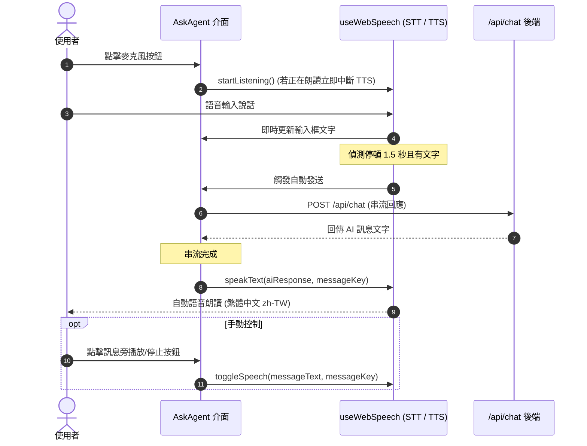

# 實作計畫：新增 AI Agent 語音功能

> 前置需求依據：[REQUIREMENT.md](./REQUIREMENT.md)

## 1. 目標說明 (Goal Description)
落實 [REQUIREMENT.md](./REQUIREMENT.md) 規範，在前端 `AskAgent.vue` 引入基於瀏覽器原生 Web Speech API 的語音輸入 (STT) 與語音朗讀 (TTS) 雙向互動功能。實現點擊錄音、1.5 秒靜音停頓自動送出、AI 回覆自動朗讀、手動播放/停止控制與智慧打斷 (Barge-in) 機制。

## 2. 系統架構與技術選型 (Architecture & Design)
採用純前端瀏覽器原生 Web Speech API (`SpeechRecognition` / `webkitSpeechRecognition` 與 `window.speechSynthesis`)，後端 API 維持零變更。



### 模組與介面設計
於 `frontend/src/composables/useWebSpeech.ts` 提供專用 Composable：
```typescript
export interface WebSpeechOptions {
  lang?: string
  silenceDelay?: number
  onAutoSubmit?: (transcript: string) => void
}

export function useWebSpeech(options?: WebSpeechOptions) {
  // 響應式狀態
  const isListening = ref<boolean>(false)
  const isSpeaking = ref<boolean>(false)
  const currentSpeakingKey = ref<string | null>(null)
  const isSupported = ref<boolean>(true)
  const errorMessage = ref<string | null>(null)

  // 核心方法
  function startListening(): void
  function stopListening(): void
  function speakText(text: string, key?: string): void
  function stopSpeaking(): void
  function toggleSpeech(text: string, key: string): void

  return { ... }
}
```

## 3. 需使用者審閱事項 (User Review Required)
> [!NOTE]
> Web Speech API 為瀏覽器原生技術，在 Google Chrome、Microsoft Edge 等 Chromium 核心瀏覽器及 Safari 提供最佳支援；在不支援的環境中系統將自動隱藏或置灰語音按鈕，完全不影響原有的文字對話。

## 4. 檔案異動清單 (Proposed Changes)
- `[NEW] frontend/src/composables/useWebSpeech.ts`：封裝 STT 語音辨識（支援停頓偵測、空值防護）、TTS 語音朗讀（Markdown 清洗、zh-TW 語音匹配）與打斷互斥邏輯。
- `[MODIFY] frontend/src/components/AskAgent.vue`：
  - 輸入列引入語音錄製控制按鈕與錄音脈衝動畫。
  - 串流回應結束後自動觸發朗讀。
  - 每則 AI 訊息加入朗讀/停止播放操作按鈕。
- `[MODIFY] frontend/src/components/ai-elements/prompt-input/PromptInputSpeechButton.vue`：擴充客製化控制或由 `AskAgent.vue` 整合專屬控制。

## 5. 驗證與測試計畫 (Verification Plan)
- **自動化建置驗證**：
  - 執行 `npm run build` 於 `frontend` 目錄，確保 TypeScript 型別與打包皆無任何錯誤。
- **人工驗證步驟**：
  1. 進入 AI Agent 對話窗，確認麥克風按鈕正常呈現。
  2. 點擊麥克風按鈕說話，確認文字即時帶入，停頓約 1.5 秒後自動觸發送出。
  3. AI 回覆完成後，確認系統自動進行繁體中文語音朗讀。
  4. 朗讀進行中點擊麥克風說話，確認朗讀即時停止並開始收音（智慧打斷）。
  5. 點擊 AI 訊息旁之音量圖示，確認可手動暫停與再次播放朗讀。
  6. 點擊錄音後若無說話（安靜），確認停頓後自動重置且不送出空訊息。
