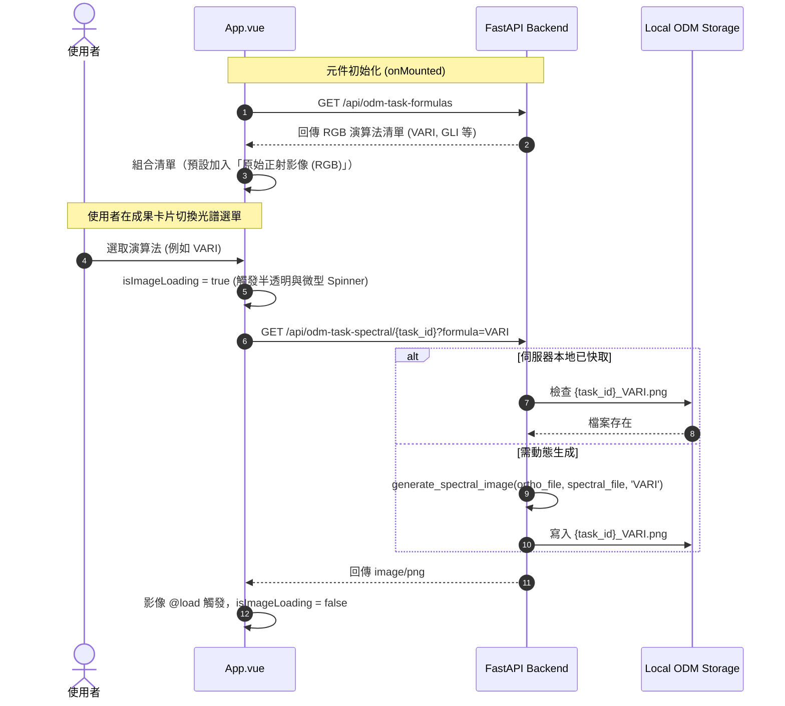

# 實作計畫：成果影像下拉選單切換光譜圖片 (PLAN.md)

> 前置需求依據：[REQUIREMENT.md](./REQUIREMENT.md)

## 1. 目標說明 (Goal Description)
落實 [REQUIREMENT.md](./REQUIREMENT.md) 之訪談結論，於前端專案成果卡片標題列加入光譜演算法切換下拉選單（Select），完全移除原有之「開啟原圖」與「下載影像」按鈕，並動態串接後端 `/api/odm-task-formulas` 及 `/api/odm-task-spectral/{id}?formula={algo}`，達成原始正射影像與各式植生指標光譜圖之即時切換與平滑載入。

## 2. 系統架構與技術選型 (Architecture & Design)

### 2.1 資料流架構與互動流程


### 2.2 介面與狀態管理設計
- **狀態定義**：
  - `formulas = ref<Formula[]>([])`：存放 `/api/odm-task-formulas` 回傳之演算法資料。
  - `selectedFormula = ref<string>('rgb')`：當前選中之指標（`'rgb'` 代表原始正射圖）。
  - `isImageLoading = ref<boolean>(false)`：控制切換期間之載入中狀態。
  - `currentImageUrl = computed(...)`：動態計算影像來源 URL。
- **元件結構**：
  - 使用現有 `@/components/ui/select` 中的 `Select`, `SelectTrigger`, `SelectValue`, `SelectContent`, `SelectGroup`, `SelectItem`。
  - 放置於 `CardHeader` 內部右側（與 `CardTitle` 同行），替換原本的兩顆按鈕。
- **專案切換連動**：
  - `watch(selectedProject)` 觸發時將 `selectedFormula.value` 重設為 `'rgb'`，確保不會發生切換不同專案後狀態錯置。

## 3. 需使用者審閱事項 (User Review Required)

> [!IMPORTANT]
> **按鈕移除確認**：
> 依訪談要求，本次更動將**徹底移除**成果卡片標題列的「開啟原圖」與「下載影像」兩顆按鈕，改為精簡下拉選單。此處為不可逆的 UI 簡化異動。

> [!NOTE]
> **演算法計算效能**：
> 若伺服器端尚未生成過特定光譜圖（如首次切換至某指標），後端需即時計算並生成 PNG。前端已規劃 `isImageLoading` 與 `Spinner` 覆蓋層，確保使用者有明確視覺回饋。

## 4. 檔案異動清單 (Proposed Changes)

按影響順序標記：
- `[MODIFY] frontend/src/App.vue`：
  - **Imports 調整**：
    - 引入 `Select`, `SelectTrigger`, `SelectValue`, `SelectContent`, `SelectGroup`, `SelectItem`。
    - 移除未使用的 `ExternalLink`, `Download` Lucide 圖示。
    - 引入 `computed`（若尚未引入）。
  - **Script 邏輯**：
    - 定義 `Formula` 介面。
    - 宣告 `formulas`, `selectedFormula`, `isImageLoading`, `currentImageUrl`。
    - 在 `onMounted` 增加呼叫 `/api/odm-task-formulas`。
    - 在 `watch(selectedProject)` 中加入 `selectedFormula.value = 'rgb'`。
    - 監聽 `selectedFormula` 變更時標記 `isImageLoading.value = true`。
  - **Template 佈局**：
    - 在正射影像成果卡片標題列移除舊按鈕，加入 `<Select>` 元件。
    - 在影像預覽容器內加入 Loading Overlay 與微型 `<Spinner>`，監聽 `` 的 `@load` 與 `@error` 事件。

## 5. 驗證與測試計畫 (Verification Plan)

### 5.1 自動化構建驗證
- **前端建置測試**：
  ```bash
  cd frontend && npm run build
  ```
  確保 TypeScript 型別無報錯，Vite 產出 production bundle 無異常。

### 5.2 人工驗證步驟
1. 開啟前端畫面並選取任一已完成（progress = 100%）之專案。
2. 檢查成果卡片標題列右側是否顯示下拉選單，且原先的「開啟原圖」與「下載影像」已消失。
3. 檢查下拉選單預設值是否為「原始正射影像 (RGB)」，並能展開列出 VARI、GLI 等後端支援之指標。
4. 點選「VARI」或其他光譜指標，觀察影像是否顯示載入中遮罩，並順利切換為偽彩色植生光譜圖。
5. 點選回「原始正射影像 (RGB)」，確認影像能無誤切換回原始彩色航拍圖。
6. 切換至側邊欄其他專案，確認下拉選單自動重置為「原始正射影像 (RGB)」。
