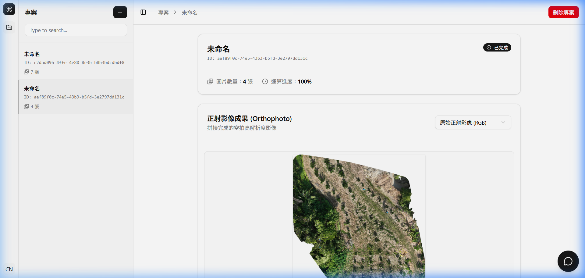
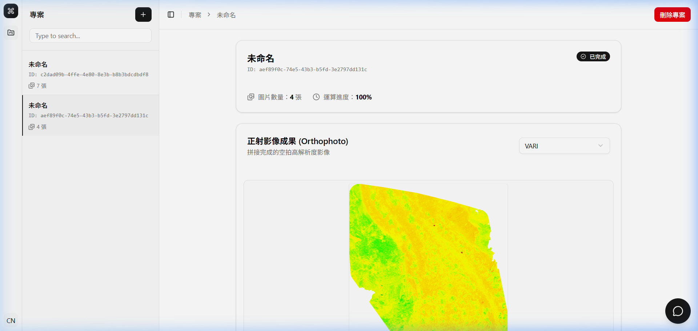
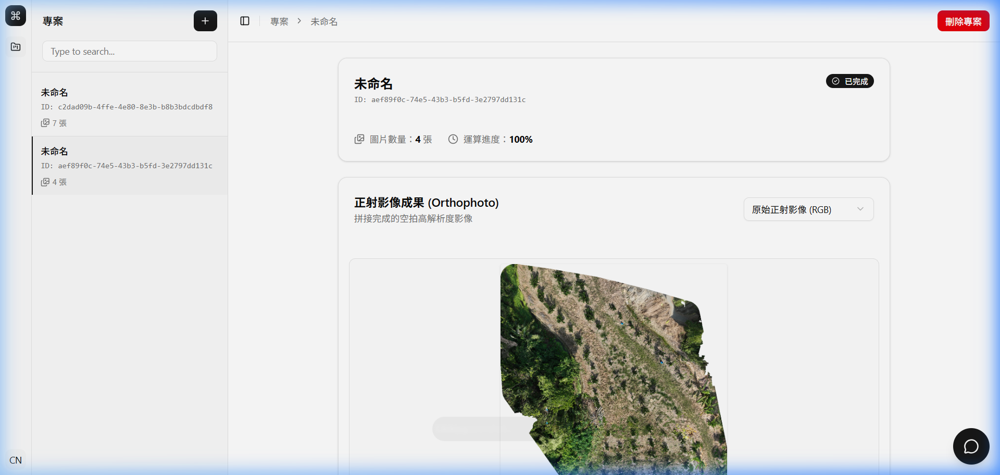

# 成果展示書 (Walkthrough)：成果影像下拉選單切換光譜圖片

> 關聯任務：[REQUIREMENT.md](./REQUIREMENT.md) | [PLAN.md](./PLAN.md) | [TASKS.md](./TASKS.md)

## 1. 執行成果總結 (Summary)
本次 Issue 已全數實作完畢，並通過程式碼靜態建置檢查與真實瀏覽器端到端操作驗證。
成功於專案成果卡片標題列加入 `Select` 下拉選單元件，取代原有的「開啟原圖」與「下載影像」按鈕；並與後端 `/api/odm-task-formulas` 及 `/api/odm-task-spectral/{id}?formula={algo}` 完整串接，支援即時切換多種 RGB 植生指數光譜圖（如 VARI 等）與原始正射影像，並提供平滑的載入指示遮罩。

## 2. 所做的變更清單 (Changes Made)
- `[MODIFY] frontend/src/App.vue`：
  - **型別與元件引入**：定義 `Formula` 介面，引入 shadcn-vue `Select` 系列子元件（`Select`, `SelectContent`, `SelectGroup`, `SelectItem`, `SelectTrigger`, `SelectValue`）及 `computed`，並移除未使用的 `ExternalLink` 與 `Download` 圖示。
  - **狀態與資料計算**：
    - 宣告 `formulas` 清單、當前選定之指標代碼 `selectedFormula`（預設 `'rgb'`）及載入旗標 `isImageLoading`。
    - 實作 `currentImageUrl` 計算屬性：當選定 `'rgb'` 時動態指向原始正射影像，其餘選取則傳遞 `formula` 參數請求後端多光譜影像。
    - 加入 `watch(selectedFormula)` 於選項切換時自動啟動載入狀態。
  - **生命週期與事件**：
    - 於 `onMounted` 階段向 `/api/odm-task-formulas` 取得系統支援之植生指標清單。
    - 於 `watch(selectedProject)` 階段切換專案時，自動將選取項目重設為預設原圖 `'rgb'`。
  - **介面佈局與載入反饋**：
    - 標題列右側替換為寬度 `w-[200px]` 之 `<Select>` 元件。
    - 影像預覽容器增加 `relative` 定位與半透明 Loading 遮罩（包含微型 `Spinner` 與說明字樣）。
    - 於 `` 綁定 `@load` 與 `@error` 原生 DOM 事件，確保圖片下載解碼完成或失敗時均能自動解除載入遮罩。

## 3. 測試與驗證項目 (Testing & Verification)

### 自動化測試指令與輸出
- **前端建置測試指令**：
  ```bash
  cd frontend && npm run build
  ```
- **執行結果**：
  ```
  ✓ built in 1.73s
  The command exited with code 0.
  ```
  - TypeScript 型別檢查完全通過，無任何編譯報錯。
  - Vite / Rollup 產出最佳化 Production Bundle 順利完成。

### 手動 / 端到端驗收項目
1. **下拉選單佈局檢查**：成果卡片標題列右上角原「開啟原圖」與「下載影像」已成功移除，替換為簡潔的下拉選單。
2. **選項載入與預設值**：進入專案時，預設顯示「原始正射影像 (RGB)」，展開後動態列出後端演算法清單（NDYI、vNDVI、VARI、MPRI、EXG、GLI）。
3. **光譜影像切換**：點選 VARI 後，預覽區顯示載入指示遮罩，後端計算完成後順利渲染綠/黃/紅三色之 VARI 植生指數光譜圖。
4. **還原原始正射圖**：點選「原始正射影像 (RGB)」後，圖片即刻還原為原始彩色航拍圖。
5. **專案切換連動**：切換至側邊欄其他專案時，下拉選單自動回歸「原始正射影像 (RGB)」。

## 4. 驗證成果與操作演示 (Visual & Flow Demos)

### 關鍵功能截圖展示
1. **成果卡片標題列下拉選單（預設原始正射影像 RGB）**
   

2. **展開下拉選單（動態顯示後端 RGB 植生指數清單）**
   

3. **選取 VARI 光譜圖（成功切換並渲染植生指數圖）**
   

4. **切換還原為原始正射影像**
   

### 端到端操作錄影
- **操作錄影展示**：
  

## 5. 驗收準則達成核對 (Acceptance Checklist)
對照 [REQUIREMENT.md](./REQUIREMENT.md) 的驗收條件逐一確認：
- [x] **成果卡片標題列成功移除「開啟原圖」與「下載影像」按鈕**：已移除舊動作按鈕，介面簡潔且無跑版。
- [x] **標題列右側成功呈現下拉選單（Select）**：採用 shadcn-vue `Select` 元件，包含「原始正射影像 (RGB)」與後端 API 回傳之完整演算法。
- [x] **切換至各光譜演算法時正確載入顯示**：選取 VARI 成功取得並展示偽彩色植生光譜分析圖。
- [x] **切換回「原始正射影像 (RGB)」時正確還原**：重新選擇原圖選項後立即還原彩色正射圖。
- [x] **切換不同專案時自動重設**：`watch(selectedProject)` 確保每次專案切換皆回到預設原圖。
- [x] **TypeScript 與建置無報錯**：`npm run build` 退出碼 0，前端編譯完全通過。
